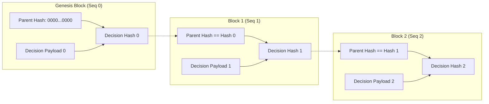

# CBE Decision Hash Chain Specification

**Sprint:** 11.15 Prospective Research Readiness & Shadow Decision Protocol  
**Cryptographic Primitive:** SHA-256 (FIPS PUB 180-4)  
**Encoding:** UTF-8 / Hexadecimal String (lowercase 64 chars)  
**Canonical Serialization:** RFC 8785 (JSON Canonicalization Scheme / Sorted Keys Compact)  

---

## 1. Overview & Purpose

The Decision Hash Chain provides an append-only, tamper-evident cryptographic ledger for shadow decisions issued by the Coin Behavior Engine.

In quantitative research, retroactive alteration of backtest decisions, post-hoc parameter tweaking, and selective timestamp filtering plague empirical claims. The Decision Hash Chain mathematically guarantees:
1. **Temporal Immutability:** Decisions cannot be retroactively modified, deleted, or inserted without instantly invalidating the cryptographic chain head.
2. **Causal Non-Contamination:** Decision $t$ is sealed and linked to historical hashes before market outcome $t+k$ is observed.
3. **Auditability:** Any independent third party can verify the integrity of the ledger in linear time $O(N)$ with zero trust assumptions.

---

## 2. Chain Architecture & Linkage



### 2.1. Genesis Block (Sequence 0)
The genesis block establishes the anchor of the prospective shadow ledger:
- `sequence_number`: `0`
- `parent_decision_hash`: `0000000000000000000000000000000000000000000000000000000000000000` (64 hexadecimal zeros)
- `decision_hash`: $\text{SHA256}(\text{CanonicalJSON}(\text{GenesisRecord}))$

### 2.2. Successor Blocks (Sequence $i \ge 1$)
Every subsequent decision record must strictly satisfy:
$$\text{parent\_decision\_hash}_i = \text{decision\_hash}_{i-1}$$
$$\text{sequence\_number}_i = i$$
$$\text{decision\_hash}_i = \text{SHA256}(\text{CanonicalJSON}(\text{Payload}_i))$$

If any bit in $\text{Payload}_{i-1}$ is modified post-hoc, its hash $\text{decision\_hash}_{i-1}' \ne \text{decision\_hash}_{i-1}$, causing an instant cryptographic linkage mismatch at record $i$.

---

## 3. Canonical Serialization Rules

To ensure bit-level deterministic hashing across operating systems, programming languages, and runtime architectures:

1. **Key Sorting:** All dictionary/JSON keys are sorted alphabetically in ascending ASCII order.
2. **Compact Separators:** Separators are strictly `(",", ":")` with zero extraneous whitespace around punctuation.
3. **Float Precision Normalization:**
   - Reference prices, balance amounts, and equity values are rounded to 4 decimal places.
   - BTC quantities are rounded to 8 decimal places.
   - Probabilities and uncertainty values are rounded to 6 decimal places.
4. **UTF-8 Character Encoding:** All strings are encoded using standard UTF-8 before passing to the SHA-256 digest function.
5. **Self-Exclusion of Seal:** The `decision_hash` field itself is excluded from the hash preimage payload.

---

## 4. Decoupled Outcome Ledger Linkage

To strictly prevent future market outcomes from contaminating decision preimages:
- **Decision Record:** Contains only information available at candle close $t$ ($\le \text{data\_availability\_timestamp}$).
- **Outcome Record:** Stored in a separate ledger, generated at horizon close $t+k$, containing:
  - `parent_decision_hash`: Identical to the target decision's `decision_hash`.
  - `evaluation_horizon_bars`: Number of bars evaluated.
  - `realized_net_pnl_usdt`: Actual simulated PnL under Policy V2 friction.
  - `subsequent_mae_pct` / `subsequent_mfe_pct`: Excursion statistics.
  - `avoided_drawdown_pct` / `missed_appreciation_pct`: Opportunity metrics.
  - `outcome_hash`: $\text{SHA256}(\text{CanonicalJSON}(\text{OutcomePayload}))$.

---

## 5. Verification Algorithm (Python Implementation)

```python
def verify_hash_chain(records: List[ShadowDecisionRecord]) -> Tuple[bool, Optional[str]]:
    """Verify an entire decision hash chain in O(N) time."""
    if not records:
        return True, None

    for i, rec in enumerate(records):
        # 1. Monotonic sequence check
        if rec.sequence_number != i:
            return False, f"Sequence violation at index {i}: record sequence is {rec.sequence_number}"

        # 2. Parent link check
        if i == 0:
            if rec.parent_decision_hash != "0" * 64:
                return False, f"Genesis parent hash invalid at index 0: {rec.parent_decision_hash}"
        else:
            prev = records[i - 1]
            if rec.parent_decision_hash != prev.decision_hash:
                return False, f"Broken chain link between index {i-1} and {i}"

        # 3. Payload integrity check
        computed_hash = rec.compute_hash()
        if rec.decision_hash != computed_hash:
            return False, f"Tampered record at index {i}: hash {rec.decision_hash} != {computed_hash}"

    return True, None
```
