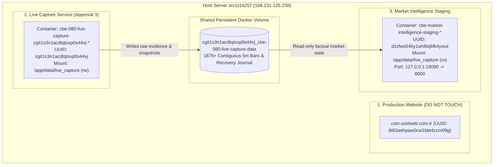
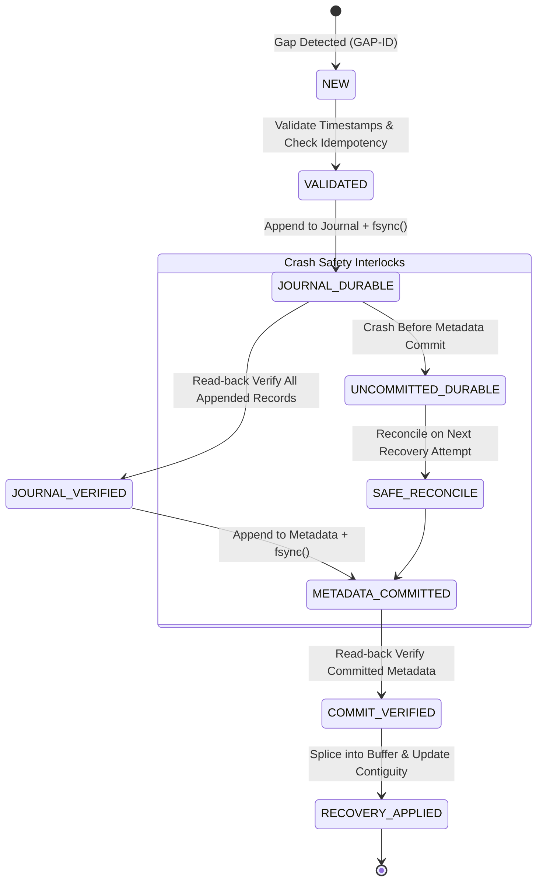

# Coin Behavior Engine (CBE) — Live Capture & Staging Operational Runbook
## Deployment Continuity, Resource Boundaries, Evidence Protection & Recovery

**Document Version:** 1.1.0 (Sprint 11.02D.1 Hardening Baseline)  
**Host Environment:** `srv1114257` (`168.231.125.238`)  
**Orchestration Engine:** Coolify v4.4.6 + Docker Compose  
**Security Gating:** APPROVAL_3 = LIVE_CAPTURE_ONLY | APPROVAL_4 = FALSE | TRADING = DISABLED

---

## 1. Operational Resource Topology & Strict Boundaries

The host environment runs three strictly separated services. Operations on one resource must NEVER touch or affect the others.



### 1.1 Production Website (FROZEN / UNTOUCHABLE)
- **URL:** `https://coin.ozelweb.com.tr`
- **Coolify Resource UUID:** `6t63aehpaw0cw1bbt4zcm09g`
- **Rules:** No restart, no redeployment, no configuration change, no database modifications.

### 1.2 Market Intelligence Staging
- **Coolify Resource UUID:** `dzzfws54by1whlbq6fk4ywut`
- **Container Name Pattern:** `cbe-market-intelligence-staging-dzzfws54by1whlbq6fk4ywut-*`
- **Host Port Binding:** `127.0.0.1:18080 -> 8000` (Localhost-bound only)
- **Volume Mount:** `zgit1s3n1acdtqtsxp0s44vj_cbe-080-live-capture-data:/app/data/live_capture:ro` (STRICTLY READ-ONLY)
- **Access Method:** `ssh -L 18080:127.0.0.1:18080 root@168.231.125.238` $\rightarrow$ `http://127.0.0.1:18080/intelligence`

### 1.3 Live Capture Service (Approval 3)
- **Coolify Resource UUID:** `zgit1s3n1acdtqtsxp0s44vj`
- **Container Name Pattern:** `cbe-080-live-capture-zgit1s3n1acdtqtsxp0s44vj-*`
- **Volume Mount:** `zgit1s3n1acdtqtsxp0s44vj_cbe-080-live-capture-data:/app/data/live_capture:rw` (EXCLUSIVE WRITER)
- **Image Tag (Coolify Mutable):** `cbe-080-shadow:coolify-live-capture`
- **Dedicated Build Dockerfile:** `deploy/shadow_v080/Dockerfile.staging`
- **Entrypoint:** `/app/entrypoint_live_capture.sh`
- **Network:** `zgit1s3n1acdtqtsxp0s44vj` (Docker bridge)

---

## 2. Persistent Data Volume & Evidence Immutability

The persistent volume is:
```text
zgit1s3n1acdtqtsxp0s44vj_cbe-080-live-capture-data
```
Host directory:
```text
/var/lib/docker/volumes/zgit1s3n1acdtqtsxp0s44vj_cbe-080-live-capture-data/_data
```

### Volume Layout & Contained Artifacts
```text
/app/data/live_capture/
├── live_market_state.json                 # Real-time atomic snapshot (for Staging UI)
├── snapshots/
│   └── btcusdt_factual_latest.json        # Primary factual snapshot copy
├── raw_market/
│   ├── raw_candles_BTCUSDT_5m.jsonl       # Immutable live WebSocket candle hash chain
│   ├── index_BTCUSDT_5m.sqlite3           # Disk index for O(1) timestamp lookup
│   ├── recovery_candles_BTCUSDT_5m.jsonl  # Append-only REST gap recovery evidence journal
│   └── recovery_metadata_BTCUSDT_5m.jsonl # Committed gap recovery audit metadata
└── quarantine/
    ├── quarantined_candles_BTCUSDT_5m.jsonl
    └── recovery_quarantine_BTCUSDT_5m.jsonl
```

### Non-Negotiable Invariants:
1. **Zero Data Loss:** Never delete, truncate, or wipe this volume.
2. **Zero Rewriting:** Never insert recovered candles into `raw_candles_BTCUSDT_5m.jsonl`.
3. **Dedicated Recovery Journal:** All recovered candles reside in `recovery_candles_BTCUSDT_5m.jsonl`.
4. **Single Writer:** Only `cbe-080-live-capture` mounts this volume with `:rw`. Staging mounts `:ro`.

---

## 2.1 Sprint 11.02D.1 Recovery Transaction Architecture & Durability

Sprint 11.02D.1 implements a deterministic, crash-safe recovery transaction state machine and cross-layer verification:



### Core Durability Guarantees:
1. **Full Read-Back Verification (Defect B):**
   - After writing to `recovery_candles_BTCUSDT_5m.jsonl` and calling `fsync()`, the store reopens the journal from disk, seeks to the exact batch range, and verifies byte-for-byte and field-for-field: entry index, `gap_id`, `recovery_batch_id`, previous recovery hash, candle SHA-256 hash, entry integrity hash, and full OHLCV payload.
   - Metadata is NEVER appended if read-back verification fails.
2. **Fail-Closed Metadata Loading (Defect C):**
   - Any corruption, malformed JSON, duplicate gap ID, or missing required fields in `recovery_metadata_BTCUSDT_5m.jsonl` raises `RecoveryMetadataCorruptionError` immediately. Silent fallback or empty-index initialization is strictly prohibited.
3. **Journal & Metadata Cross-Validation (Defect D):**
   - On startup, every committed metadata record is cross-validated against the verified journal records: `first_entry_index`, `last_entry_index`, `recovered_candles_count`, `missing_timestamps`, `start_integrity_hash`, `end_integrity_hash`, `gap_id`, and `recovery_batch_id`. Any discrepancy fails closed immediately.
4. **Uncommitted Batch Safe Reconciliation (Defect A):**
   - If a crash occurs after journal `fsync()` but before metadata commit, the journal records remain safely on disk. On restart, the store identifies these entries as uncommitted.
   - When a recovery request for the same gap arrives, the candidate candles are compared with the uncommitted journal entries. If matching, the transaction reconciles safely and commits metadata without appending duplicate journal records.
5. **Strict Canonical Payload Idempotency (Defect E):**
   - Duplicate recovery requests are validated using `matches_payload()` and Decimal string representations of open, high, low, close, and volume. If identical, returns `(True, "ALREADY_COMMITTED")`. If any value conflicts, the record is quarantined to `recovery_quarantine_BTCUSDT_5m.jsonl` and `ConflictingRecoveryCandleError` is raised.
6. **Metadata Rollback on Write/Fsync Failure:**
   - If metadata write or `fsync()` encounters a disk failure, the metadata file is immediately truncated back to its pre-write byte position (`meta_pos`), preventing half-written or un-synced commit records on disk.

---

## 3. Dedicated Build & Image Versioning

### 3.1 Why the Root Dockerfile Must NOT Be Used for Live Capture
- The root `Dockerfile` is a general-purpose build that does NOT contain `/app/entrypoint_live_capture.sh`.
- Building Live Capture with the root `Dockerfile` results in immediate container failure (`exec: entrypoint_live_capture.sh: not found`).

### 3.2 Correct Dockerfile & Immutable Tagging Procedure
Always build using `deploy/shadow_v080/Dockerfile.staging`:

```bash
# 1. Fetch latest verified commit
git checkout main && git pull origin main
COMMIT_SHA=$(git rev-parse --short HEAD)

# 2. Build immutable release image
docker build \
  -t cbe-080-shadow:sprint11-02d1-${COMMIT_SHA} \
  -f deploy/shadow_v080/Dockerfile.staging .

# 3. Tag with Coolify image reference
docker tag \
  cbe-080-shadow:sprint11-02d1-${COMMIT_SHA} \
  cbe-080-shadow:coolify-live-capture
```

---

## 4. Configuration Drift: Generated Coolify Compose vs Repository

Coolify stores generated Compose configurations at:
```text
/data/coolify/applications/zgit1s3n1acdtqtsxp0s44vj/docker-compose.yaml
```

### Known Drift Points & Reconciliation:
| Item | Generated Coolify Compose | Repository Compose Template | Required Server State |
|---|---|---|---|
| **Volume Name** | `zgit1s3n1acdtqtsxp0s44vj_cbe-080-live-capture-data` | `${CBE_CAPTURE_VOLUME_NAME:-...}` | Must match exact server volume |
| **Secondary Volume** | Contains unused declaration `cbe_080_live_capture_data` | Aligned via `${CBE_CAPTURE_VOLUME_NAME}` | Keep actual mounted volume unchanged |
| **Network** | External network `zgit1s3n1acdtqtsxp0s44vj` | Default bridge | Must ensure `zgit1s3n1acdtqtsxp0s44vj` exists |
| **Restart Policy** | `restart: "no"` | `restart: "no"` | Change to `restart: unless-stopped` only when continuous capture authorized |

### Network Preflight Check (Idempotent):
```bash
docker network inspect zgit1s3n1acdtqtsxp0s44vj >/dev/null 2>&1 || \
docker network create --driver bridge zgit1s3n1acdtqtsxp0s44vj
```

---

## 5. Preflight Verification (Read-Only)

Before any deployment, execute the hardened read-only preflight tool. It supports `--help` and `--compose-path` to audit either the repository template or the actual Coolify-generated compose file on the server:

```bash
# Inspect repository template (default):
python3 deploy/shadow_v080/verify_deployment_preflight.py

# Inspect actual Coolify server compose file:
python3 deploy/shadow_v080/verify_deployment_preflight.py \
  --compose-path /data/coolify/applications/zgit1s3n1acdtqtsxp0s44vj/docker-compose.yaml

# Display CLI help and invariants:
python3 deploy/shadow_v080/verify_deployment_preflight.py --help
```

Expected output:
```text
==================================================================
CBE-0.8.0 LIVE CAPTURE: READ-ONLY DEPLOYMENT PREFLIGHT AUDIT
==================================================================
[PREFLIGHT PASSED] All Dockerfile, volume, entrypoint, and safety interlocks verified.
```
If ANY mismatch occurs, execution aborts with exit code 1. Secrets (tokens, keys, passwords) are automatically redacted in diagnostics.

---

## 6. Safe Deployment Procedure (When Explicitly Authorized)

> [!CAUTION]
> Do NOT execute these commands without explicit user authorization:
> `DEPLOYMENT_AUTHORIZED=YES` and `LIVE_CAPTURE_START_AUTHORIZED=YES`.

### Step 1: Pre-Deployment Audit
```bash
# Verify volume integrity and existing entries
docker run --rm \
  -v zgit1s3n1acdtqtsxp0s44vj_cbe-080-live-capture-data:/data:ro \
  alpine ls -la /data/raw_market
```

### Step 2: Build & Tag Image
```bash
cd /opt/cbe-sprint11-02d-build
git pull origin main
docker build -t cbe-080-shadow:sprint11-02d-capture -f deploy/shadow_v080/Dockerfile.staging .
docker tag cbe-080-shadow:sprint11-02d-capture cbe-080-shadow:coolify-live-capture
```

### Step 3: Start Live Capture via Docker Compose
```bash
docker compose \
  -f /data/coolify/applications/zgit1s3n1acdtqtsxp0s44vj/docker-compose.yaml \
  --project-directory /data/coolify/applications/zgit1s3n1acdtqtsxp0s44vj \
  up -d --no-deps --no-build --force-recreate cbe-080-live-capture
```

### Step 4: Verification Checklist (First 15 Minutes)
1. **Startup Logs:**
   ```bash
   docker logs --tail 50 cbe_080_coolify_live_capture
   ```
   Verify:
   - `Verified N market evidence entries. Chain intact.`
   - `Recovery journal verified: M entries.`
   - `WebSocket connected to: stream.binance.com:9443/ws/btcusdt@kline_5m`
2. **Snapshot Freshness:**
   Verify `/app/data/live_capture/live_market_state.json` updates with fresh `writer_heartbeat_utc`.
3. **Gap Recovery (if gap detected):**
   Verify logs indicate:
   - `Unrecovered sequence gap detected (GAP-...). Triggering REST recovery...`
   - `Durable gap recovery committed: gap_id=GAP-..., count=141`
   - `Gap GAP-... successfully recovered via REST.`
4. **Staging UI Verification:**
   Via SSH tunnel (`http://127.0.0.1:18080/intelligence`), verify spot price is current and classification indicates `LIVE_OBSERVED`.

---

## 7. Rollback Procedure

If the new image fails or exhibits unexpected behavior:

### Step 1: Stop Failing Live Capture
```bash
docker stop cbe_080_coolify_live_capture
```

### Step 2: Roll Back Image Reference
Re-tag the previous known-good image (Sprint 11.02C or previous SHA):
```bash
docker tag cbe-080-shadow:sprint11-02c-capture cbe-080-shadow:coolify-live-capture
```

### Step 3: Restart Previous Version
```bash
docker compose \
  -f /data/coolify/applications/zgit1s3n1acdtqtsxp0s44vj/docker-compose.yaml \
  --project-directory /data/coolify/applications/zgit1s3n1acdtqtsxp0s44vj \
  up -d --no-deps --no-build --force-recreate cbe-080-live-capture
```

### Evidence Safety During Rollback:
- The persistent volume `zgit1s3n1acdtqtsxp0s44vj_cbe-080-live-capture-data` is NEVER touched or deleted during rollback.
- Newly collected candles remain preserved in the append-only JSONL files.
- The Market Intelligence Staging UI will continue reading the snapshot or fall back to canonical baseline without downtime.

---

## 8. Independent Research Readiness & Evidence Integrity Audit (Sprint 11.02E)

Sprint 11.02E provides a strictly read-only, offline, non-mutating auditor that evaluates whether captured live market evidence meets rigorous scientific and quantitative criteria for offline research use.

### 8.1 Core Principles
- **No Blind Trust:** Does not rely on `is_research_eligible=true` from engine/dashboard; independently re-derives all metrics.
- **Strict Read-Only:** Never acquires write locks, rebuilds SQLite indexes, truncates files, or creates quarantine files.
- **Fail-Closed:** Any hash break, sequence gap, uncommitted recovery entry, or safety violation immediately results in `NOT_READY` or `INDETERMINATE`.
- **5 Evaluation Gates:**
  1. `EVIDENCE_INTEGRITY`: SHA-256 hash chains of raw evidence, recovery journal, and recovery metadata cross-validation.
  2. `TEMPORAL_CONTINUITY`: Strict 300,000 ms spacing, boundary alignment, closed-candle flags, zero duplicates or out-of-order bars.
  3. `RECOVERY_CORRECTNESS`: Exact timestamp matching for recovered gaps, zero raw candle overwrites, zero uncommitted entries leaking into research timeline.
  4. `RESEARCH_WINDOW_READINESS`: Full warmup window (>= 288 contiguous closed 5m bars = 24 hours) unbroken at head of timeline.
  5. `AUTHORIZATION_SAFETY`: Runtime environment interlocks (`CBE_TRADING_DISABLED=true`, `CBE_PROSPECTIVE_OBSERVATION_ENABLED=false`, `CBE_APPROVAL_4_AUTHORIZED=false`).

### 8.2 Execution Commands

#### Local / Staging Execution:
```bash
python deploy/shadow_v080/audit_research_readiness.py \
  --evidence-dir /app/data/live_capture \
  --output-json /tmp/research_readiness_audit.json \
  --output-md /tmp/research_readiness_audit.md \
  --compare-engine \
  --strict
```

#### Low-Resource VPS / Containerized Run:
```bash
docker run --rm \
  -v zgit1s3n1acdtqtsxp0s44vj_cbe-080-live-capture-data:/evidence:ro \
  cbe-080-shadow:coolify-live-capture \
  python deploy/shadow_v080/audit_research_readiness.py \
    --evidence-dir /evidence \
    --strict
```

### 8.3 Verdict Classifications
- `READY_FOR_OFFLINE_RESEARCH`: All 5 gates passed. Certified for historical backtesting and offline research only. (Trading and prospective scoring remain forbidden).
- `NOT_READY`: One or more gates failed (e.g. warmup incomplete, unrecovered gap, hash mismatch). Research must not proceed.
- `INDETERMINATE`: Missing evidence files or file modification detected during audit.

