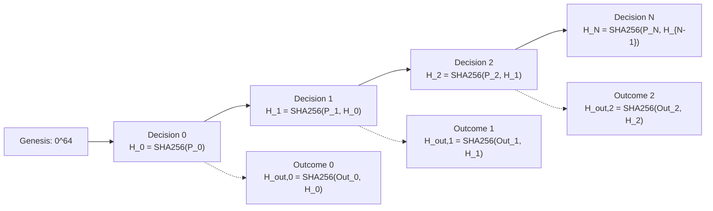

# CBE Decision Hash Chain Specification
## Cryptographic Immutability & Causal Audit Protocol for Shadow Decisions

**Standard:** CBE Prospective Research Protocol — Sprint 11.15  
**Version:** 1.0.0-canonical  
**Cryptographic Primitive:** SHA-256 (FIPS 180-4)  
**Encoding:** UTF-8 Canonical JSON (RFC 8785)  
**Parent Genesis Hash:** `0000000000000000000000000000000000000000000000000000000000000000` (64 zero hex characters)

---

## 1. Objectives & Threat Model

In algorithmic trading research, retrospective backtests suffer from selection bias, curve-fitting, and subtle data leakage. When transitioning to prospective observation, research integrity requires that decision records issued at time $t$ cannot be retroactively altered, replaced, backdated, or deleted once subsequent market prices become known.

The **Decision Hash Chain** guarantees:
1. **Append-Only Immutability:** Any post-hoc mutation of an historical decision alters its cryptographic hash, breaking all downstream parent links in the chain.
2. **Causal Event Ordering:** Decision $i$ strictly commits to the entire historical sequence $0 \dots i-1$ before observation $i+1$ is evaluated.
3. **Decoupled Outcome Verification:** Market outcomes and financial payoffs are recorded in separate `ShadowOutcomeRecord` structures referencing the decision's immutable hash, preventing outcome leakage from contaminating decision generation.
4. **Independent Auditability:** Any third party can independently re-hash the ledger in $O(N)$ time to mathematically verify tamper-free execution.

---

## 2. Canonical JSON Serialization Rules

To ensure identical SHA-256 hashes across different programming languages, platforms, and runtime environments, payloads must be serialized using strict Canonical JSON encoding:

1. **Deterministic Key Ordering:** All JSON object keys must be sorted lexicographically by Unicode codepoints (`sort_keys=True`).
2. **Zero Insignificant Whitespace:** Delimiters must be strictly formatted with no whitespace after commas or colons (`separators=(",", ":")`).
3. **Floating-Point Representation Standards:**
   - Spot prices and reference prices: rounded to exactly 4 decimal places (`round(p, 4)`).
   - Asset balances (BTC): rounded to exactly 8 decimal places (`round(q, 8)`).
   - Fiat balances (USDT) and portfolio equity: rounded to exactly 4 decimal places (`round(c, 4)`).
   - Probability scores and uncertainty: rounded to exactly 6 decimal places (`round(prob, 6)`).
4. **UTF-8 Character Encoding:** Strings must be encoded in raw UTF-8 without byte-order marks (BOM).

---

## 3. Mathematical Chain Specification

### 3.1. Genesis Decision ($i = 0$)
The first decision record in any prospective evaluation period has sequence number $0$ and binds to the canonical genesis hash:
$$H_{\text{parent}, 0} = 0^{64}$$
The canonical genesis payload $\mathcal{P}_0$ is constructed from all fields of `ShadowDecisionRecord` with `parent_decision_hash` set to $0^{64}$.
$$H_0 = \text{SHA256}(\text{CanonicalJSON}(\mathcal{P}_0))$$

### 3.2. Recursive Step ($i \ge 1$)
For any subsequent decision record $i$ issued at observation timestamp $t_i$:
1. The record's `sequence_number` must equal $i$.
2. The record's `parent_decision_hash` must equal the prior sealed hash:
   $$H_{\text{parent}, i} = H_{i-1}$$
3. The canonical payload $\mathcal{P}_i$ incorporates $H_{\text{parent}, i}$.
4. The record is sealed with:
   $$H_i = \text{SHA256}(\text{CanonicalJSON}(\mathcal{P}_i))$$



---

## 4. Tamper Detection & Security Proof

Suppose an adversary attempts to modify decision record $k$ (for example, altering `decision` from `WAIT_USDT` to `BUY_CANDIDATE` after observing a subsequent price rally):

1. The adversary modifies payload $\mathcal{P}_k \to \mathcal{P}_k^*$.
2. Because SHA-256 is collision-resistant:
   $$H_k^* = \text{SHA256}(\text{CanonicalJSON}(\mathcal{P}_k^*)) \ne H_k$$
3. When verifying decision $k+1$, the parent hash check evaluates:
   $$\mathcal{P}_{k+1}.\text{parent\_decision\_hash} \stackrel{?}{=} H_k^*$$
   Since $\mathcal{P}_{k+1}.\text{parent\_decision\_hash}$ was recorded as $H_k$, the equality fails:
   $$H_k \ne H_k^* \implies \text{CHAIN INTEGRITY FAILURE AT SEQUENCE } k+1$$
4. If the adversary also attempts to rewrite $H_{\text{parent}, k+1} = H_k^*$, then $H_{k+1}$ changes, cascading through all downstream blocks $k+1 \dots N$.
5. The adversary cannot forge the chain head hash $H_N$ without rewriting the entire history and generating an entirely different root head, which will fail comparison against any previously published or notarized checkpoint.

---

## 5. Decoupled Outcome Architecture

Future market outcomes are explicitly prohibited from existing in `ShadowDecisionRecord`. Instead, outcomes are recorded in separate `ShadowOutcomeRecord` entities:

1. **Outcome Schema Linkage:** Each outcome record specifies `parent_decision_hash: H_i`.
2. **Evaluation Delay:** An outcome record for decision $i$ across horizon $h$ (e.g. 288 bars / 24 hours) can only be generated at timestamp $t \ge t_i + h \times 5\text{m}$.
3. **Independent Sealing:**
   $$H_{\text{out}, i} = \text{SHA256}(\text{CanonicalJSON}(\mathcal{O}_i))$$
4. **Zero Backward Leakage:** If market data is corrupted or unavailable during the outcome evaluation window, only the outcome record is marked incomplete; the underlying decision record $H_i$ remains sealed and permanently immutable.

---

## 6. Verification Algorithm

The verification procedure is deterministic and runs in $O(N)$ linear time:

```python
def verify_hash_chain_integrity(records: List[ShadowDecisionRecord]) -> Tuple[bool, Optional[str]]:
    if not records:
        return True, None

    for idx, rec in enumerate(records):
        # 1. Monotonic sequence check
        if rec.sequence_number != idx:
            return False, f"Sequence corruption at index {idx}: expected {idx}, found {rec.sequence_number}"

        # 2. Parent hash link check
        if idx == 0:
            if rec.parent_decision_hash != "0" * 64:
                return False, f"Genesis parent hash invalid at index 0: {rec.parent_decision_hash}"
        else:
            prev = records[idx - 1]
            if rec.parent_decision_hash != prev.decision_hash:
                return False, f"Broken chain link at index {idx}: parent {rec.parent_decision_hash} != prev {prev.decision_hash}"

        # 3. Content cryptographic hash check
        computed = rec.compute_hash()
        if rec.decision_hash != computed:
            return False, f"Tampered record payload at index {idx}: recorded {rec.decision_hash} != computed {computed}"

    return True, None
```

---

## 7. Storage & Ledger Invariants

- **Storage Format:** Append-only JSON Lines (`.jsonl`) or Parquet format with sequential block writes.
- **Fail-Closed Operations:** Any disk write failure or hash verification mismatch immediately halts the decision engine with a critical panic exit code, preventing further decision generation until operator resolution.
- **Notarization:** Chain head hashes $H_N$ can be periodically notarized (e.g. logged to an immutable Git commit, external timestamp authority, or distributed ledger) for unassailable prospective proof.
