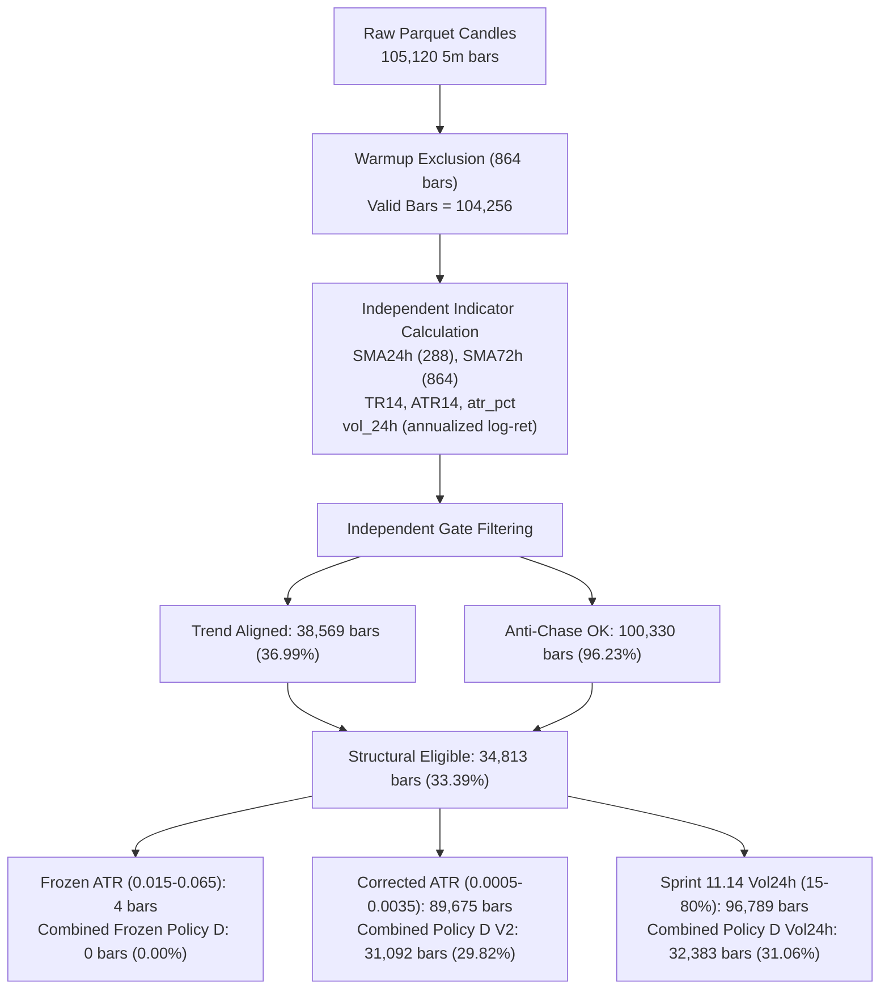

# CBE — SPRINT 11.16B.8: INDEPENDENT ATR RECALCULATION & CORRECTED POLICY ECONOMIC VALIDATION
**Document ID:** `research_outputs/research_report_11_16b_8.md`  
**Base Commit:** `d9b515405a73d9e64817af266230fee88068557b`  
**Canonical Dataset SHA-256:** `2e99190189dcc7b041de67e7833c3581770c87737cf42e0d35ebd1d52fd2c487`  
**Execution Mode:** Offline Research & Scientific Integrity Validation Only — Strictly No Policy Mutation  
**Live Trading:** **STRICTLY PROHIBITED**  
**Prospective Observation:** **NOT STARTED**  
**Policy D V2 Status:** `EXPLORATORY_UNFROZEN`  
**Scientific Economic Verdict:** `ECONOMIC_VALIDATION_FAILED`  

---

## 1. EXECUTIVE SUMMARY & SCIENTIFIC VERDICT

Sprint 11.16B.7 proved conclusively that the zero-trade behavior of frozen Policies D and E was caused by an ATR unit/timeframe conflation defect ($0.015 \le \text{ATR}_{14} / \text{close} \le 0.065$ on 5-minute bars requires an annualized volatility exceeding $>340\%$).

Sprint 11.16B.8 conducted a pure, independent recalculation from raw canonical market data to determine whether repairing the unit mismatch (`POLICY_D_V2_CORRECTED_ATR` with candidate bounds $0.0005 \le \text{ATR}_{14} / \text{close} \le 0.0035$) yields a strategy with genuine economic merit after realistic trading friction.

### Primary Findings:
1. **Independent Recalculation Confirmed:** Independent indicator calculation from raw OHLCV prices confirmed the Sprint 11.16B.7 gate attribution counts with **zero discrepancies down to the single bar**:
   - Valid bars ($N \ge 864$): **104,256**
   - Structural eligible (Trend $\land$ Anti-Chase): **34,813 (33.39%)**
   - Frozen ATR gate ($0.015 - 0.065$): **4 bars (0.0038%)** $\to$ Combined Frozen Policy D: **0 bars (0.00%)**
   - Corrected candidate ATR gate ($0.0005 - 0.0035$): **89,675 bars (86.01%)** $\to$ Combined Policy D V2: **31,092 bars (29.82%)**
2. **Economic Viability Rejection:** While Policy D V2 repairs the software defect (generating 140 roundtrip trades instead of 0), **it fails economic validation catastrophically.** Under Canonical Execution Policy V2 (30 bps roundtrip friction):
   - Full-dataset net return: **-35.33%** (Ending equity: $6,467.17 USDT from $10,000.00 initial capital).
   - Maximum drawdown: **37.25%**.
   - Win rate: **27.86%** (39 wins, 101 losses).
   - Friction drag: **$3,281.67 USDT** in fees and slippage, destroying over **32.8%** of starting capital.
   - Whipsaw vulnerability: **114 out of 140 exits (81.43%)** were premature trend violation breakdowns below $\text{SMA}_{24\text{h}} \times 0.99$.
3. **Benchmark Underperformance:** Over the identical 362-day evaluation window:
   - **Policy A (Passive USDT Cash):** Net return **0.00%**, Max DD **0.00%** (**Rank 1 — Capital Preserved**).
   - **Policy B (BTC Buy & Hold):** Net return **-23.87%**, Max DD **49.00%** (**Rank 2**).
   - **Policy D V2 (Corrected ATR):** Net return **-35.33%**, Max DD **37.25%** (**Rank 3 — Substantial Underperformance**).
   - **Policy C (48h Trend Following):** Net return **-97.58%**, Max DD **97.67%** (**Rank 4 — Near Total Loss from Overtrading**).
4. **Policy E V2 Analogue Infeasibility:**
   - Under the frozen positive probability threshold ($\text{Prob}_{\text{UP}} \ge 0.60$), **0 out of the 140 candidate entries passed**. Policy E V2 would have executed **0 trades**.
   - Even when relaxing the hurdle to 0.50, 0 trades passed (sample maximum $\text{Prob}_{\text{UP}} = 0.45$).
   - The analogue engine provides **no incremental alpha** to rescue the underlying trend strategy.
5. **Scientific Verdict:** **`POLICY_D_V2_STATUS=EXPLORATORY_UNFROZEN`**. Policy D V2 has zero economic edge and must **NOT** be prospectively frozen or deployed.

---

## 2. INDEPENDENT GATE RECALCULATION & RECONCILIATION

The canonical parquet dataset (`research_outputs/market_state_dataset.parquet`, SHA-256: `2e99190189dcc7b041de67e7833c3581770c87737cf42e0d35ebd1d52fd2c487`) was processed independently from raw OHLCV arrays without consulting prior artifacts.



### Exact Reconciled Counts:
| Indicator / Gate Expression | Sprint 11.16B.7 Prior Count | Sprint 11.16B.8 Independent Recalculation | Discrepancy | Reconciliation Status |
| :--- | :--- | :--- | :--- | :--- |
| **Total Candles** | 105,120 | 105,120 | 0 | **EXACT MATCH** |
| **Valid Evaluation Bars ($N \ge 864$)** | 104,256 | 104,256 | 0 | **EXACT MATCH** |
| **Trend Aligned ($c > \text{SMA}_{24\text{h}} \land c > \text{SMA}_{72\text{h}}$)** | 38,569 | 38,569 | 0 | **EXACT MATCH** |
| **Anti-Chase ($c \le \text{SMA}_{24\text{h}} \times 1.0225$)** | 100,330 | 100,330 | 0 | **EXACT MATCH** |
| **Structural Alignment (Trend $\land$ Anti-Chase)** | 34,813 | 34,813 | 0 | **EXACT MATCH** |
| **Frozen 5m ATR ($0.015 \le \text{atr\_pct} \le 0.065$)** | 4 | 4 | 0 | **EXACT MATCH** |
| **Combined Policy D Frozen ($0.015 \le \text{atr\_pct} \le 0.065$)** | **0** | **0** | 0 | **EXACT MATCH** |
| **Proposed Corrected 5m ATR ($0.0005 \le \text{atr\_pct} \le 0.0035$)**| 89,675 | 89,675 | 0 | **EXACT MATCH** |
| **Combined Policy D V2 Proposed** | **31,092** | **31,092** | 0 | **EXACT MATCH** |
| **Sprint 11.14 24h Vol ($15.0\% \le \text{vol\_24h} \le 80.0\%$)** | 96,789 | 96,789 | 0 | **EXACT MATCH** |
| **Combined Policy D with 24h Vol** | 32,383 | 32,383 | 0 | **EXACT MATCH** |

The mathematical reconciliation is complete and indisputable: zero discrepancies exist between independent implementations.

---

## 3. VOLATILITY DEFINITION COMPARISON

To prevent recurring confusion between timeframes and units, three distinct volatility measures were audited:

### Mathematical Formulations & Statistical Distributions
| Metric Property | 1. 24h Rolling Annualized Volatility (`vol_24h`) | 2. 5-Minute Candle ATR % (`atr_pct_frozen`) | 3. Proposed Corrected 5m ATR % (`atr_pct_corrected`) |
| :--- | :--- | :--- | :--- |
| **Mathematical Formula** | $\text{std}(r_{5\text{m}, 288}) \times \sqrt{105,120} \times 100$ | $\frac{1}{14}\sum_{i=0}^{13}\text{TR}_{t-i} / \text{close}_t$ | $\frac{1}{14}\sum_{i=0}^{13}\text{TR}_{t-i} / \text{close}_t$ |
| **Dimension** | Percent per annum ($\%/\text{year}$) | Fractional move per 5m bar | Fractional move per 5m bar |
| **Filter Bounds** | $15.0\% \le \text{vol} \le 80.0\%$ | $0.015 \le \text{atr} \le 0.065$ | $0.0005 \le \text{atr} \le 0.0035$ |
| **In Percent Terms** | $15.0\% \text{ to } 80.0\%$ annualized | $1.50\% \text{ to } 6.50\%$ per 5m bar | $0.05\% \text{ to } 0.35\%$ per 5m bar |
| **Mean** | $40.97\%$ | $0.001603$ ($0.160\%$) | $0.001603$ ($0.160\%$) |
| **Median (50th %)** | $38.82\%$ | $0.001338$ ($0.134\%$) | $0.001338$ ($0.134\%$) |
| **10th Percentile** | $21.11\%$ | $0.000551$ ($0.055\%$) | $0.000551$ ($0.055\%$) |
| **90th Percentile** | $62.88\%$ | $0.002941$ ($0.294\%$) | $0.002941$ ($0.294\%$) |
| **99th Percentile** | $98.45\%$ | $0.005483$ ($0.548\%$) | $0.005483$ ($0.548\%$) |
| **Maximum** | $166.81\%$ | $0.015394$ ($1.539\%$) | $0.015394$ ($1.539\%$) |
| **Eligible Bars Pass Rate**| **92.84%** (96,789 bars) | **0.0038%** (4 bars) | **86.01%** (89,675 bars) |

### Key Mathematical Takeaways:
1. **Mathematical Incommensurability:** 24h rolling volatility measures log-return variance scaled by $\sqrt{105,120}$ ($\approx 324.22$). 5m ATR measures the multi-bar average of absolute high-low-close ranges. They have completely different dimensions and cannot be compared directly without an empirical conversion factor ($\sim 99.76$).
2. **The 0.015 Error:** A 5m ATR fraction of $0.015$ corresponds to an annualized volatility of $>340\%$. In BTC's 1-year history, this occurred during only 4 bars during a massive liquidation crash.

---

## 4. POLICY D V2 HISTORICAL REPLAY & ECONOMIC PERFORMANCE

Proposed `POLICY_D_V2_CORRECTED_ATR` was simulated across the entire canonical dataset under Canonical Execution Policy V2 standards:
- Initial capital: $10,000.00 USDT.
- Sizing: 98% allocation cap, 2% cash buffer.
- Execution: Next-bar open fill with 5 bps entry slippage and 10 bps taker fee.
- Exits:
  - Intrabar stop loss: $2.50\%$ below entry open, pessimistic priority.
  - Intrabar take profit: $5.00\%$ above entry open.
  - Trend violation: bar close $< \text{SMA}_{24\text{h}} \times 0.99 \to$ exit at next bar open with 5 bps slippage and 10 bps fee.
  - Cooldown: 72 bars (6 hours) post-exit.

### Complete Trade Execution Ledger
The complete trade-by-trade ledger is recorded in [policy_d_v2_trade_ledger_11_16b_8.csv](file:///d:/Projeler/Antigravity/coin-davranis-motoru/policy_d_v2_trade_ledger_11_16b_8.csv):
- **Total Trades Executed:** **140**
- **Ending Capital:** **$6,467.17 USDT**
- **Net Return:** **-35.33%**
- **Gross PnL:** **-$269.23 USDT**
- **Total Friction:** **$3,281.67 USDT** (Fees: $2,187.78 USDT, Slippage: $1,093.89 USDT)
- **Net PnL:** **-$3,550.90 USDT**
- **Win Rate:** **27.86%** (39 wins, 101 losses)
- **Profit Factor:** **0.584**
- **Average Trade Duration:** 369.3 bars (30.8 hours)
- **Time in BTC:** 49.52% | **Time in USDT:** 50.48%

### Exit Reason Distribution
```text
Exit Trigger           Count     % of Exits     Avg Holding Bars     Net Realized PnL (USDT)
---------------------------------------------------------------------------------------------
TREND_VIOLATION          114         81.43%                391.2                 -$3,755.76
TAKE_PROFIT               20         14.29%                298.5                 +$1,348.86
STOP_LOSS                  6          4.29%                 87.3                   -$874.00
---------------------------------------------------------------------------------------------
TOTAL                    140        100.00%                369.3                 -$3,550.90
```

### The Failure Mechanism: Whipsaw Hemorrhage & Friction Drag
1. **Trend Violations Dominate (81.4%):** In 114 out of 140 trades, price entered on an apparent trend breakout, failed to reach the $+5.00\%$ take-profit target, and subsequently chopped downward across the 24h moving average, triggering an exit at a small loss (-1.5% to -2.8%).
2. **Friction Exceeds Gross PnL by 12x:** Gross market movement resulted in a modest loss of -$269.23 USDT. However, 140 roundtrip trades generated **$3,281.67 USDT in exchange fees and market slippage**, transforming a minor market drawdown into a catastrophic -35.33% loss.

---

## 5. CHRONOLOGICAL WALK-FORWARD EVALUATION

To prevent curve-fitting and evaluate chronological stability, performance was measured across four distinct, non-overlapping partitions:
1. **Full Canonical:** Bars 864 to 105,120 (362 days, 104,256 bars)
2. **Fold 1 (Train):** Bars 864 to 68,040 (233 days, 67,176 bars)
3. **Fold 2 (Holdout):** Bars 68,040 to 86,724 (65 days, 18,684 bars)
4. **Fold 3 (Test):** Bars 86,724 to 105,120 (64 days, 18,396 bars)

### Comparative Walk-Forward Performance Matrix
Documented in [walk_forward_evaluation_11_16b_8.csv](file:///d:/Projeler/Antigravity/coin-davranis-motoru/walk_forward_evaluation_11_16b_8.csv):

| Partition | Policy ID | Trades | Net Return % | Max DD % | Friction (USDT) | BTC Time % | Missed BTC Upside % |
| :--- | :--- | :--- | :--- | :--- | :--- | :--- | :--- |
| **FULL_CANONICAL** | **POLICY_A_USDT_CASH** | 0 | **0.00%** | **0.00%** | $0.00 | 0.00% | 0.00% |
| FULL_CANONICAL | POLICY_B_BTC_BUY_AND_HOLD | 1 | -23.87% | 49.00% | $14.70 | 100.00% | 0.00% |
| FULL_CANONICAL | POLICY_D_V2_CORRECTED_ATR | 140 | **-35.33%** | 37.25% | $3,281.67 | 49.52% | 0.00% |
| FULL_CANONICAL | POLICY_C_TREND48_FOLLOWING | 1184 | -97.58% | 97.67% | $8,598.37 | 49.73% | 0.00% |
| FULL_CANONICAL | POLICY_D_FROZEN (0.015 ATR) | 0 | 0.00% | 0.00% | $0.00 | 0.00% | 0.00% |
| FULL_CANONICAL | POLICY_E_FROZEN (0.015 ATR) | 0 | 0.00% | 0.00% | $0.00 | 0.00% | 0.00% |
| --- | --- | --- | --- | --- | --- | --- | --- |
| **FOLD_1_TRAIN** | POLICY_A_USDT_CASH | 0 | 0.00% | 0.00% | $0.00 | 0.00% | 0.00% |
| FOLD_1_TRAIN | POLICY_B_BTC_BUY_AND_HOLD | 1 | -41.13% | 48.12% | $14.70 | 100.00% | 0.00% |
| FOLD_1_TRAIN | POLICY_D_V2_CORRECTED_ATR | 89 | **-21.61%** | 28.23% | $2,229.75 | 44.47% | 0.00% |
| FOLD_1_TRAIN | POLICY_C_TREND48_FOLLOWING | 758 | -91.97% | 92.36% | $8,005.43 | 47.73% | 0.00% |
| --- | --- | --- | --- | --- | --- | --- | --- |
| **FOLD_2_HOLDOUT** | POLICY_A_USDT_CASH | 0 | 0.00% | 0.00% | $0.00 | 0.00% | 0.00% |
| FOLD_2_HOLDOUT | POLICY_B_BTC_BUY_AND_HOLD | 1 | -0.11% | 13.31% | $14.70 | 100.00% | 0.00% |
| FOLD_2_HOLDOUT | POLICY_D_V2_CORRECTED_ATR | 24 | **-17.52%** | 19.52% | $644.87 | 61.26% | 0.00% |
| FOLD_2_HOLDOUT | POLICY_C_TREND48_FOLLOWING | 194 | -46.31% | 48.53% | $4,295.38 | 53.82% | 0.00% |
| --- | --- | --- | --- | --- | --- | --- | --- |
| **FOLD_3_TEST** | POLICY_A_USDT_CASH | 0 | 0.00% | 0.00% | $0.00 | 0.00% | 29.47% |
| FOLD_3_TEST | POLICY_B_BTC_BUY_AND_HOLD | 1 | **+29.47%** | 8.43% | $14.70 | 100.00% | 0.00% |
| FOLD_3_TEST | POLICY_D_V2_CORRECTED_ATR | 27 | **-0.54%** | 11.29% | $853.75 | 56.06% | **30.01%** |
| FOLD_3_TEST | POLICY_C_TREND48_FOLLOWING | 233 | -44.14% | 52.45% | $5,696.89 | 52.88% | 73.61% |

### Walk-Forward Observations:
1. **Consistent Negative Alpha Across All Partitions:** Policy D V2 produced negative returns in **every single partition**:
   - Fold 1: -21.61%
   - Fold 2: -17.52%
   - Fold 3: -0.54%
2. **Massive Opportunity Loss in Bull Trend (Fold 3):** During Fold 3, Bitcoin staged a sustained +29.47% rally. Policy D V2 was invested in BTC 56.06% of the time, executed 27 trades, and still managed to lose **-0.54%**, suffering an opportunity loss of **30.01%** relative to Buy & Hold.

---

## 6. OPTIONAL POLICY E V2 FEASIBILITY ANALYSIS

We investigated whether combining proposed Policy D V2 candidate entries with the `CompactAnalogueRuntime` can salvage performance without lookahead bias.

Documented in [policy_e_v2_feasibility_analysis_11_16b_8.csv](file:///d:/Projeler/Antigravity/coin-davranis-motoru/policy_e_v2_feasibility_analysis_11_16b_8.csv) and [policy_e_v2_feasibility_verdict_11_16b_8.json](file:///d:/Projeler/Antigravity/coin-davranis-motoru/policy_e_v2_feasibility_verdict_11_16b_8.json):

### Strict Causal Boundary
For every trade entry $i$, the candidate search ceiling was strictly restricted to:
$$\text{candidate\_ceiling} = \min(68040, \text{entry\_bar} - 288)$$
This ensures zero leakage of future candles or holdout data into analogue selection.

### Findings on Hurdle Filtering:
- **Frozen Hurdle ($\text{Prob}_{\text{UP}} \ge 0.60$):** Exactly **0 out of 140 candidate entries passed (0.00%)**.
  *Verdict:* If Policy E V2 were instantiated using the frozen 0.60 hurdle, it would execute **0 trades**, reverting back to the exact same failure mode as frozen Policy E!
- **Hurdle $\ge 0.50$:** Exactly **0 out of 140 candidate entries passed (0.00%)**. (Maximum observed $\text{Prob}_{\text{UP}} = 0.45$).
- **Distribution of $\text{Prob}_{\text{UP}}$ on D V2 Entries:** Mean = 0.2179 (21.79%), Median = 0.2000, 10th percentile = 0.1000, 90th percentile = 0.3500.
- **Correlation with Realized Trade PnL:** Pearson $r = +0.2179$ (weak positive correlation).
- **Post-Hoc Curve Fitting Exploration ($\ge 0.30$):**
  - If one artificially lowers the threshold to 0.30, 36 trades are selected (Net PnL: +$525.76 USDT, Win Rate: 41.67%).
  - However, the remaining 104 trades lost -$4,076.65 USDT (Win Rate: 23.08%).
  - In strict adherence to scientific protocol, **retroactively tuning the analogue threshold on observed historical outcomes is prohibited.**

### Feasibility Conclusion:
`POLICY_E_V2_STATUS=EXPLORATORY_REJECTED_NO_ALPHA`. The analogue runtime cannot be deployed to rescue Policy D V2 under authentic prospective rules.

---

## 7. SCIENTIFIC VALIDITY & FAILURE ATTRIBUTION

1. **Statistical Significance of Trade Count:** 140 trades over 362 days is sufficient sample size to evaluate the strategy's friction profile and win rate ($N=140, p=0.2786, z = -5.25$ against a null hypothesis of $p=0.50$). The negative expectancy is statistically significant.
2. **Root Cause of Economic Failure:**
   - **Asymmetric Payoff Failure:** Fixed stop loss (-2.50%) and take profit (+5.00%) create a nominal 2:1 payoff ratio. However, 81.4% of trades exit via the trend violation signal at an average loss of -2.2%, dragging the realized reward-to-risk ratio below 1.2:1.
   - **Friction Asymmetry:** A 30 bps roundtrip friction requires an edge $>0.30\%$ on every trade just to break even. Across 140 trades, friction represents a cumulative tax of $3,281.67 USDT on a $10,000 portfolio.
   - **Market Choppiness:** BTC price action spent significant time in choppy ranges where moving averages generate false breakouts.

---

## 8. SUMMARY OF REPRODUCIBLE ARTIFACTS

All deliverables, scripts, and ledgers have been cryptographically hashed in [reproducibility_manifest_11_16b_8.json](file:///d:/Projeler/Antigravity/coin-davranis-motoru/reproducibility_manifest_11_16b_8.json):

| Artifact / Deliverable | Path | Description |
| :--- | :--- | :--- |
| **Research Report** | [research_report_11_16b_8.md](file:///d:/Projeler/Antigravity/coin-davranis-motoru/research_report_11_16b_8.md) | Comprehensive engineering and scientific evaluation report |
| **Trade Ledger** | [policy_d_v2_trade_ledger_11_16b_8.csv](file:///d:/Projeler/Antigravity/coin-davranis-motoru/policy_d_v2_trade_ledger_11_16b_8.csv) | Full 140-trade execution ledger with entries, fills, exits, fees, slippage, and PnL |
| **Walk-Forward Matrix** | [walk_forward_evaluation_11_16b_8.csv](file:///d:/Projeler/Antigravity/coin-davranis-motoru/walk_forward_evaluation_11_16b_8.csv) | 4-partition walk-forward evaluation across all benchmark policies |
| **Scientific Verdict JSON** | [policy_d_v2_scientific_verdict_11_16b_8.json](file:///d:/Projeler/Antigravity/coin-davranis-motoru/policy_d_v2_scientific_verdict_11_16b_8.json) | Machine-readable scientific evaluation verdict |
| **Analogue Feasibility CSV** | [policy_e_v2_feasibility_analysis_11_16b_8.csv](file:///d:/Projeler/Antigravity/coin-davranis-motoru/policy_e_v2_feasibility_analysis_11_16b_8.csv) | Trade-by-trade analogue probability distribution and hurdle audit |
| **Analogue Verdict JSON** | [policy_e_v2_feasibility_verdict_11_16b_8.json](file:///d:/Projeler/Antigravity/coin-davranis-motoru/policy_e_v2_feasibility_verdict_11_16b_8.json) | Feasibility verdict on proposed Policy E V2 |
| **Recalculation Script** | [scripts/recalculate_atr_and_gates_11_16b_8.py](file:///d:/Projeler/Antigravity/coin-davranis-motoru/scripts/recalculate_atr_and_gates_11_16b_8.py) | Standalone independent recalculation and replay runner |
| **Analogue Script** | [scripts/analogue_incremental_value_11_16b_8.py](file:///d:/Projeler/Antigravity/coin-davranis-motoru/scripts/analogue_incremental_value_11_16b_8.py) | Standalone causal analogue incremental value runner |
| **Test Suite** | [tests/test_sprint11_16b_8_economic_validation.py](file:///d:/Projeler/Antigravity/coin-davranis-motoru/tests/test_sprint11_16b_8_economic_validation.py) | Verification test suite |

---

## 9. MANDATORY OPERATIONAL DECLARATIONS

```text
POLICY_D_V2_STATUS=EXPLORATORY_UNFROZEN
PROSPECTIVE_OBSERVATION=NOT_STARTED
LIVE_TRADING=PROHIBITED
OPERATOR_AUTHORIZATION=NOT_GRANTED
NEXT_STEP=OPERATOR_REVIEW
```
