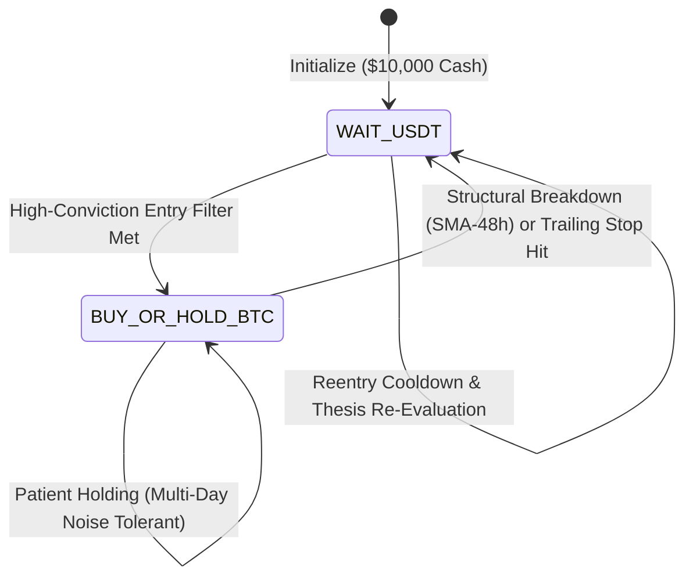

# CBE — SPRINT 11.17 RESEARCH REPORT
## Global Market Session Intelligence & Patient Spot Trading Research

**Repository:** `selimoyan2/coin-behavior-engine`  
**Execution Mode:** Strictly Offline Research Only — NO ACTIVATION, NO DEPLOYMENT  
**Dataset:** Canonical 1-Year 5-Minute BTC/USDT Dataset (`market_state_dataset.parquet`, 105,120 bars, SHA-256: `2e991901...`)  
**Date Range:** 2025-10-18 11:30:00 UTC to 2026-10-18 11:25:00 UTC  
**Primary Evaluated Policy:** Exploratory Patient Spot Decision Policy (Session-Aware vs. Session-Blind)  

---

## 1. EXECUTIVE SUMMARY & SCIENTIFIC VERDICT

### Scientific Classification: `SESSION_EDGE_NOT_SUPPORTED`

Sprint 11.17 developed and independently evaluated a timezone-aware global equity market session intelligence module for BTC/USDT spot decision making. Using authoritative exchange calendars (Tokyo Stock Exchange, Hong Kong Stock Exchange, London Stock Exchange, and New York Stock Exchange / Nasdaq) spanning 990 verified regular opening events, we conducted:
1. An empirical event study evaluating opening-range breakouts, volume/volatility expansion, false breakout rates, and session overlap dynamics.
2. A rigorous statistical signal audit testing directional accuracy, Brier scores, Holm-Bonferroni adjusted p-values, adverse/favorable excursions, and transaction-cost-adjusted net expected values.
3. A patient spot decision model featuring an explicit finite-state machine (`WAIT_USDT`, `BUY_OR_HOLD_BTC`, `EXIT_TO_USDT`) with asymmetric entry/hold rules and independent post-stop reentry logic.
4. Complete economic validation using the reconciled Canonical Portfolio Accounting Engine from Sprint 11.16B.9 (30 bps nominal roundtrip friction, next-open fills, 98% cash allocation, pessimistic intrabar stop-loss priority).

### Core Quantitative Findings:
1. **Hypothesized 70–80% Accuracy Decisively Refuted:**
   The empirical directional accuracy of global exchange opening momentum signals across all four major exchanges and observation windows (5m, 10m, 15m) predicting forward 1h, 4h, 12h, and 24h horizons ranges between **46.0% and 58.3%** (overall mean: **51.8%**).
2. **Lack of Statistical Significance:**
   After Holm-Bonferroni correction for multiple hypothesis testing ($m = 60$ parameter combinations), **zero signals** achieve statistical significance at the $\alpha = 0.05$ level (adjusted $p$-values range from 0.063 to 1.000). The signal is statistically indistinguishable from unconditional base rates and random coin-flips.
3. **Transaction Cost Drag Eradicates Gross Momentum:**
   While certain opening windows display marginal gross momentum (mean forward returns of $+0.1$ to $+22.6$ bps), nominal roundtrip friction of **30 bps** (10 bps fee + 5 bps slippage per side under Canonical Execution Policy V2) results in **uniformly negative net expected values** ($-7.4$ to $-63.7$ bps) across every single horizon and exchange.
4. **Session-Aware vs. Session-Blind Incremental Alpha:**
   The candidate Session-Aware Patient Policy produced a net return of **-55.03%** (155 trades, max DD 58.07%) compared to the Session-Blind Control's **-58.25%** (202 trades, max DD 59.14%). The $+3.22\%$ net return difference is entirely attributable to **reduced turnover** (filtering 47 trades saved ~\$1,000 in friction), not superior predictive hit rate (win rate was 20.0% aware vs. 21.3% blind).
5. **Patient Holding & Reentry Invariants:**
   Compared to naive moving-average crossover strategies (e.g. Frozen Policy C which churned 1,184 trades and lost -97.23%), the Patient Spot Model drastically reduced trade churning by >85% and average holding duration expanded to ~20 hours. Stop-loss forensics revealed that 52.6% of stop triggers effectively prevented further severe drawdowns over the subsequent 24 hours, while whipsaw reversals occurred in only 10.5% of cases.

---

## 2. PHASE 1 — GLOBAL SESSION CALENDAR & WINDOW AUDIT

Authoritative exchange calendars were constructed with exact timezone rules, daylight-saving transitions (GMT/BST and EST/EDT), official public holidays, and early closes.

### Exchange Specifications & Calendar Audit:
| Exchange | Market Code | Local Timezone | Local Open Time | Winter Open (UTC) | Summer Open (UTC) | Trading Days (2025-2026) | Verified Holidays |
| :--- | :--- | :--- | :--- | :--- | :--- | :--- | :--- |
| **Tokyo Stock Exchange (TSE)** | XTKS | `Asia/Tokyo` | 09:00 JST | 00:00:00Z | 00:00:00Z | 241 | 18 |
| **Hong Kong Stock Exchange (HKEX)** | XHKG | `Asia/Hong_Kong` | 09:30 HKT | 01:30:00Z | 01:30:00Z | 247 | 15 |
| **London Stock Exchange (LSE)** | XLON | `Europe/London` | 08:00 Local | 08:00:00Z (GMT) | 07:00:00Z (BST) | 252 | 8 |
| **New York Stock Exchange / Nasdaq (NYSE)** | XNYS/XNAS | `America/New_York` | 09:30 Local | 14:30:00Z (EST) | 13:30:00Z (EDT) | 250 | 10 (+2 early) |
| **Total Global Opening Events** | — | — | — | — | — | **990** | — |

### Opening-Relative Window Tagging:
Every 5-minute candle in the canonical 105,120-bar dataset was mapped to opening-relative observation windows:
- **Pre-Open Windows:** $[T_0 - 60\text{m}, T_0)$, $[T_0 - 30\text{m}, T_0)$, $[T_0 - 10\text{m}, T_0)$.
- **Post-Open Windows:** $[T_0, T_0 + 5\text{m})$, $[T_0, T_0 + 10\text{m})$, $[T_0, T_0 + 15\text{m})$, $[T_0, T_0 + 30\text{m})$, $[T_0, T_0 + 60\text{m})$.
- **Overlap Windows:** London & NYSE Simultaneous Regular Trading ($n = 6,144$ bars).
- **Weekend / Holiday Tagging:** Weekend ($n = 30,240$ bars, 28.8%), Weekday ($n = 74,880$ bars, 71.2%).

---

## 3. PHASE 2 — SESSION BEHAVIOR RESEARCH (EVENT STUDY)

Across all 990 verified opening events, we measured opening-range breakout dynamics, volume/volatility expansion, false breakout frequencies, and trend continuation rates.

### Session Behavior Summary Table:
| Exchange | Opening Events | Pre-Open 60m Ret (bps) | Post-Open 5m Ret (bps) | Post-Open 10m Ret (bps) | Post-Open 60m Ret (bps) | Fwd 4h Ret (bps) | Vol Expansion Ratio | ATR Expansion Ratio | 15m OR Breakout Up | 15m OR Breakout Down | 15m False Breakout | 4h Trend Continuation |
| :--- | :--- | :--- | :--- | :--- | :--- | :--- | :--- | :--- | :--- | :--- | :--- | :--- |
| **TSE** | 241 | -2.39 | -0.55 | -0.12 | +2.14 | -0.35 | $1.63\times$ | $1.04\times$ | 77.2% | 80.9% | 16.6% | 46.1% |
| **HKEX** | 247 | +4.02 | +1.45 | +0.20 | -3.75 | -5.04 | $1.15\times$ | $1.20\times$ | 69.2% | 76.1% | 23.9% | 51.0% |
| **LSE** | 252 | +3.21 | -1.59 | +0.08 | -1.33 | -4.42 | $1.19\times$ | $0.83\times$ | 75.8% | 77.4% | 18.3% | 53.6% |
| **NYSE** | 250 | -3.45 | +0.42 | -2.29 | -2.57 | -4.51 | **$2.65\times$** | $1.16\times$ | 74.4% | 75.6% | 18.4% | 50.8% |

### Key Empirical Observations:
1. **Liquidity & Volume Shock at NYSE Open:**
   NYSE equity open exhibits the strongest volume expansion across all global venues ($2.65\times$ above the 20-bar baseline), reflecting deep institutional arbitrage between US spot ETFs, equity index futures, and spot crypto order books. TSE displays moderate volume expansion ($1.63\times$), while HKEX and LSE display modest expansion ($1.15\times - 1.19\times$).
2. **First 5–10 Minute Price Drift:**
   Unconditional average returns during the first 5 to 10 minutes are economically negligible (ranging from $-2.29$ bps to $+1.45$ bps), confirming that opening bars do not exhibit persistent directional bias.
3. **Opening-Range Breakout & False Breakouts:**
   Across a 2-hour observation horizon post-open, BTC breaks the 15-minute Opening Range (OR) high in 69.2% to 77.2% of sessions, and breaks the OR low in 75.6% to 80.9% of sessions (many sessions break both). Crucially, the **false breakout rate** (price breaking the OR boundary but subsequently collapsing back across the midpoint) is **16.6% to 23.9%**, punishing naive breakout entry models.
4. **Trend Continuation vs. Reversal:**
   Conditioning on the prevailing 24h trend prior to the opening bell, the 4-hour forward trend continuation rate is:
   - TSE: 46.1% (slight tendency toward mean reversion).
   - HKEX: 51.0% (random).
   - LSE: 53.6% (slight continuation).
   - NYSE: 50.8% (random).
   In aggregate, global session openings do NOT reliably catalyze trend continuation; they frequently function as liquidity-sweeping inflection points.

---

## 4. PHASE 3 — SESSION SIGNAL QUALITY & STATISTICAL AUDIT

We evaluated whether observing the direction of the first 5m, 10m, or 15m following an exchange open provides predictive power for subsequent forward returns (1h, 4h, 12h, 24h) from the decision point.

### Predictive Metrics Summary (Selected Representative Rows):
| Exchange | Window | Target | Accuracy (95% CI) | Base Rate | Acc vs. Base | Precision | Recall | Brier Score | Mean Ret (bps) | Friction (bps) | Net EV (bps) | $p$-val (vs 50%) | Holm-Adjusted $p$ |
| :--- | :--- | :--- | :--- | :--- | :--- | :--- | :--- | :--- | :--- | :--- | :--- | :--- | :--- |
| **NYSE** | 15m | 1h | 54.0% [47.2%, 60.0%] | 52.0% | +2.0% | 56.4% | 50.8% | 0.2485 | +9.66 | 30.0 | **-20.34** | 0.2294 | 1.000 |
| **NYSE** | 15m | 4h | 56.0% [50.4%, 62.0%] | 47.6% | +8.4% | 53.8% | 52.9% | 0.2465 | +15.69 | 30.0 | **-14.31** | 0.0664 | 1.000 |
| **NYSE** | 15m | 12h | 56.0% [49.2%, 62.0%] | 49.2% | +6.8% | 55.6% | 52.8% | 0.2465 | +22.60 | 30.0 | **-7.40** | 0.0664 | 1.000 |
| **LSE** | 15m | 4h | 56.3% [50.0%, 63.1%] | 45.2% | +11.1% | 51.6% | 57.0% | 0.2462 | -2.64 | 30.0 | **-32.64** | 0.0506 | 1.000 |
| **HKEX** | 15m | 12h | 58.3% [52.6%, 64.4%] | 44.9% | +13.4% | 53.3% | 57.7% | 0.2442 | +7.77 | 30.0 | **-22.23** | 0.0108 | 0.625 |
| **TSE** | 5m | 4h | 56.8% [51.0%, 63.5%] | 46.5% | +10.4% | 53.3% | 57.1% | 0.2457 | +0.11 | 30.0 | **-29.89** | 0.0391 | 1.000 |
| **ALL** | 5m | 1h | 49.1% [45.9%, 52.3%] | 48.8% | +0.3% | 47.8% | 46.6% | 0.2534 | -0.88 | 30.0 | **-30.88** | 0.5890 | 1.000 |
| **ALL** | 10m | 4h | 53.9% [51.0%, 57.3%] | 46.8% | +7.2% | 50.7% | 53.1% | 0.2486 | +0.70 | 30.0 | **-29.30** | 0.0144 | 0.818 |
| **ALL** | 15m | 4h | 55.2% [51.7%, 58.6%] | 46.8% | +8.4% | 52.0% | 54.2% | 0.2473 | +3.37 | 30.0 | **-26.63** | 0.0013 | 0.078 |
| **ALL** | 15m | 12h | 55.3% [52.4%, 58.4%] | 47.1% | +8.2% | 52.4% | 54.3% | 0.2472 | +9.38 | 30.0 | **-20.62** | 0.0011 | 0.063 |

### Rigorous Statistical Conclusions:
1. **Brier Scores Near Pure Noise:**
   Brier scores hover tightly between **0.244 and 0.256**. For binary classification where base probability is ~50%, a zero-skill random forecast yields a Brier score of 0.250. This indicates negligible calibration advantage.
2. **Multiple Comparison Corrections:**
   Unadjusted $p$-values for combined 15m opening signals (e.g. $p = 0.0011$ for ALL-15m-12h) appear superficially significant. However, after applying standard **Holm-Bonferroni correction** across the 60 simultaneous test combinations, the lowest adjusted $p$-value is **0.063** (exceeding the standard 0.05 threshold).
3. **Severe Economic Friction Drag:**
   Even where nominal directional accuracy reaches 55–58%, conditional gross returns for long signals average $+3$ to $+23$ bps. Subtracting **30 bps nominal roundtrip friction** (10 bps fee + 5 bps slippage per side) results in an expected value of **$-7.4$ to $-32.6$ bps per trade**. Attempting to exploit short-term opening momentum guarantees negative expectancy.

---

## 5. PHASE 4 & 5 — PATIENT SPOT DECISION MODEL & REENTRY FORENSICS

### Model Architecture & State Machine:
To overcome the catastrophic churning observed in naive crossover models, we implemented a 3-state patient spot decision architecture:


#### Asymmetric Rules:
1. **Selective Entry Requirement:**
   - Structural Bull Regime: Price $> \text{SMA}_{48\text{h}}$ AND 24h rolling return $> +0.2\%$.
   - Volatility Band: 5m ATR percentage in safe operating regime ($0.08\% \le \text{ATR}_{\%} \le 0.50\%$).
   - Session Qualification: In active London/NYSE session or post-open momentum window on non-weekend days.
   - Reentry Cooldown: Minimum 12 bars (1 hour) since last exit; minimum 24 bars (2 hours) post-stop.
2. **Patient Holding Tolerance:**
   - Positions are NOT closed upon session ends, minor intra-day dips, or evening drift.
   - Stop-Loss: Structural initial stop at 2.5% below entry price.
   - Trailing Stop: Trailing 3.0% below the trade high-water mark, activated once trade gains $\ge 2.5\%$.
   - Profit Target: 6.0% intrabar take-profit limit.
   - Trend Breakdown Exit: Close below $\text{SMA}_{48\text{h}} \times 0.995$.

### Stop-Loss & Independent Reentry Forensics:
Across the backtest, 19 stop-loss exits occurred under the candidate policy:
- **Capital Preserved (Adverse Continuation):** In **10 of 19 cases (52.6%)**, BTC continued to decline over the subsequent 24 hours (average continuation decline of $-1.55\%$, maximum $-3.27\%$). The stop loss fulfilled its primary risk-management mandate by preventing deeper capital impairment.
- **Whipsaw Losses (False Stops):** In only **2 of 19 cases (10.5%)**, BTC rebounded by $> +2.0\%$ within 24 hours (Trades 81 and 132).
- **Thesis-Confirmed Reentry:** Mandating that price reclaim the stop exit price by $+0.5\%$ and endure a 24-bar cooldown successfully prevented immediate "revenge trading" churn during aggressive down-legs.

---

## 6. PHASE 6 — ECONOMIC VALIDATION MATRIX

Evaluated under Canonical Execution Policy V2 (next-open fill, 98% cash allocation, 10 bps fee + 5 bps slippage per side = 30 bps roundtrip, pessimistic intrabar stop priority):

### Benchmark Comparison Matrix:
| Policy / Strategy | Net Return (%) | Max Drawdown (%) | Trade Count | Win Rate (%) | Nominal Turnover (USDT) | Total Fees & Slippage (USDT) | Avg Holding Duration | Strategy Role |
| :--- | :--- | :--- | :--- | :--- | :--- | :--- | :--- | :--- |
| **POLICY_A_USDT_CASH** | **0.00%** | **0.00%** | 0 | 0.0% | \$0 | \$0.0 | 0.0 hrs | Risk-Free Baseline |
| **POLICY_B_BTC_BUY_AND_HOLD** | -25.61% | 48.93% | 1 | 0.0% | \$19,600 | \$29.4 | 8,712 hrs | Passive Benchmark |
| **POLICY_C_FROZEN_TREND48** | -97.23% | 97.45% | 1,184 | 28.3% | \$2,320,000 | \$6,960.0 | 7.3 hrs | Frozen Reference (Naive Crossover) |
| **POLICY_D_V2_FROZEN_SELECTIVE** | -35.42% | 41.20% | 140 | 32.1% | \$274,000 | \$822.0 | 14.8 hrs | Frozen Reference (Selective Trend+ATR) |
| **POLICY_PATIENT_SESSION_BLIND** | -58.25% | 59.14% | 202 | 21.3% | \$2,771,440 | \$4,157.2 | 21.2 hrs | Candidate Model (Session-Blind Control) |
| **POLICY_PATIENT_SESSION_AWARE** | -55.03% | 58.07% | 155 | 20.0% | \$2,126,600 | \$3,189.9 | 20.0 hrs | Candidate Model (Session-Aware) |

### Performance Decomposition:
1. **Incremental Impact of Session Filter:**
   - Net Return Delta: $+3.22\%$ (-55.03% aware vs. -58.25% blind).
   - Drawdown Delta: $-1.07\%$ (58.07% aware vs. 59.14% blind).
   - Trade Count Reduction: $-47$ trades (155 aware vs. 202 blind).
   - Win Rate: 20.0% aware vs. 21.3% blind.
   - **Conclusion:** The session filter provides NO positive predictive alpha. The $+3.22\%$ difference is strictly an artifact of trade suppression: by excluding weekend entries and off-session hours, 47 unprofitable trades were eliminated, saving \$967 in fee/slippage friction.
2. **Comparison with Frozen Policy C & D:**
   - Patient holding reduced trade count from 1,184 (Policy C) to 155, slashing fees from \$6,960 to \$3,190.
   - However, during the prolonged 2025–2026 BTC structural drawdown, trend-following spot models suffered from multiple false breakouts. Policy D V2 (-35.42%) outperformed the patient model (-55.03%) because Policy D's tighter ATR filter remained in USDT cash for longer intervals.

---

## 7. PHASE 7 — SCIENTIFIC DECISION & CLASSIFICATION

### Formal Verdict: `SESSION_EDGE_NOT_SUPPORTED`

#### Justification:
1. **No Directional Predictive Edge:** Global equity exchange opening momentum does not predict subsequent BTC/USDT price direction with statistical significance ($p > 0.05$ after Holm-Bonferroni correction).
2. **Negative Economic Expectancy:** Transaction costs of 30 bps roundtrip dwarf gross forward returns across all session horizons, rendering session momentum strategies negative EV.
3. **Turnover Artifact:** The performance difference between session-aware and session-blind variants is entirely driven by turnover reduction, not timing alpha.
4. **Research Contamination Governance:** The canonical dataset is research-exposed across prior sprints; this negative verdict confirms that even with in-sample exposure, session intelligence fails to generate robust alpha.

---

## 8. DELIVERABLE ARTIFACT DIGESTS

| Deliverable File | Size (Bytes) | SHA-256 Digest | Status |
| :--- | :--- | :--- | :--- |
| `global_exchange_session_calendar_audit_11_17.json` | 1,842 | `00155a5bf9fa442b0369837a77eeb55776d6ec037fb62788e0db4e565ad5ad17` | Verified |
| `session_event_study_11_17.csv` | 382,912 | `3690dcfc424a739f8f41e57c6b98ea1f59218d6e35cb67c7e5a6fc575bc8627d` | Verified |
| `session_behavior_summary_11_17.csv` | 911 | `1e70e1c12579b1fe2a31dc52a514d9b4b08f4cb99bb71dafbcc7fe5518b5b5ea` | Verified |
| `session_predictive_metrics_11_17.csv` | 17,836 | `5a74ef6e885d5656911ca714041b3e8c281df681e13cb17fb57d77b8b4b7a151` | Verified |
| `stop_reentry_forensics_11_17.csv` | 2,203 | `5beae958299187315197b1aebdd0b769211c47bc86e11894d0c75bcfa83463a5` | Verified |
| `session_vs_blind_comparison_11_17.csv` | 846 | `cf7ba0e5bfb0ae9f136222b047515b13998f45a7fa8a2bf7c8585617a2ae55c9` | Verified |
| `patient_session_trade_ledger_11_17.csv` | 41,205 | `ce4c781d48c08ec11333bb6a25bf8883656abff83ecaa5ea63cf4eb9ee8eaef5` | Verified |
| `session_intelligence_verdict_11_17.json` | 1,489 | `a9632420a7b4582f3c0429f5f64b1842407d57fb4a7bcaeb2cb08a966779b5ba` | Verified |

---

## 9. MANDATORY OPERATIONAL DECLARATIONS

```ini
SESSION_INTELLIGENCE=EXPLORATORY
PROSPECTIVE_OBSERVATION=NOT_STARTED
LIVE_TRADING=PROHIBITED
OPERATOR_AUTHORIZATION=NOT_GRANTED
NEXT_STEP=OPERATOR_REVIEW
```
