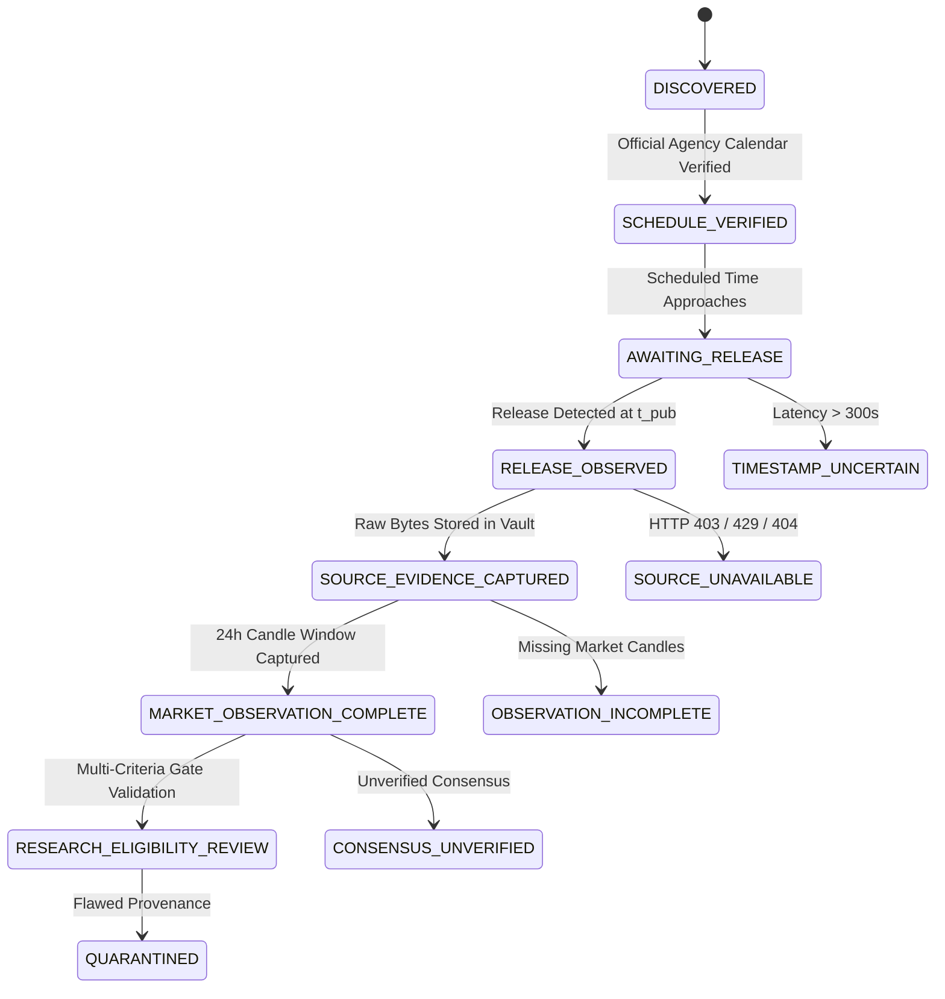

# CBE — SPRINT 11.23.3 RESEARCH REPORT
## Prospective Evidence Collection & Observation Readiness

**Repository:** `selimoyan2/coin-behavior-engine`  
**Base Commit (Full):** `61abe1aec748efcbcef6c1a84cd8f50e145a2352`  
**Base Commit (Short):** `61abe1a`  
**Target Market:** Binance BTC/USDT Spot  
**Execution Mode:** STRICTLY OFFLINE RESEARCH & SIMULATED OBSERVATION  
**Live Trading:** PROHIBITED  
**Operator Authorization:** NOT GRANTED  

---

## 1. EXECUTIVE SUMMARY & RESEARCH STATUS

Sprint 11.23.3 delivers the architecture for prospective economic-event evidence collection and market observation readiness for the Coin Behavior Engine.

The system addresses the fundamental scientific challenge established in Sprints 11.23, 11.23.1, and 11.23.2: **historical catalog evidence is contaminated by unarchived document bytes, retrospective consensus vintages, and lack of contemporaneous capture proof**. To eliminate these flaws in future research, Sprint 11.23.3 implements the complete prospective collection, validation, and storage pipeline without activating unattended production scraping or live trading.

### Core Deliverables & Technical Gates
1. **Prospective Event Registry:** Canonical registry for upcoming macroeconomic announcements and major crypto protocol milestones with strict timezone-to-UTC conversion, deterministic event IDs, and audit revision history.
2. **Extensible Source Adapters:** Modular adapters for the Bureau of Labor Statistics (BLS), Bureau of Economic Analysis (BEA), Federal Reserve Board, and crypto protocols. Features content-type validation, raw byte SHA-256 calculation, controlled exponential backoff retries, and transparent classification of HTTP 403, 429, and unavailability.
3. **Consensus Vintage Evidence Registry:** Enforces the fundamental vintage law ($t_{\text{survey}} < t_{\text{release}}$ and $t_{\text{observed}} < t_{\text{release}}$). Strictly prohibits promoting consensus to `VERIFIED` based merely on numerical matching with retrospective calendars.
4. **Content-Addressed Immutable Evidence Vault:** High-performance local vault (`data/prospective/`) using SHA-256 content addressing, atomic replace writes, duplicate avoidance, and append-only audit journaling.
5. **BTC/USDT Observation Architecture:** Research-only market observer for 1m and 5m Binance Spot candles. Enforces OHLCV validity, gap detection, deduplication, safe execution start ($\ge t_{\text{pub}} + \text{uncertainty}$), and multi-horizon descriptive metrics (-60m, +15m, +1h, +4h, +24h). Zero BUY/SELL or portfolio allocation decisions.
6. **Event Lifecycle State Machine:** Strict forward progression through 7 canonical states with 5 exceptional quarantine states (`SOURCE_UNAVAILABLE`, `TIMESTAMP_UNCERTAIN`, `CONSENSUS_UNVERIFIED`, `OBSERVATION_INCOMPLETE`, `QUARANTINED`).
7. **Simulation & Failure Suite:** 15 deterministic offline failure and boundary scenarios executed with 100% pass rate.
8. **Performance & Governance Isolation:** Bounded queues, token-bucket rate limiting, atomic checkpointing, and complete isolation from live exchange credentials and order execution modules.

---

## 2. PROSPECTIVE EVENT REGISTRY ARCHITECTURE

### Target Event Coverage
The prospective registry supports all major macroeconomic indicators and cryptocurrency structural events:
- **US Inflation:** Headline CPI YoY, Core CPI YoY, Headline PPI, Core PPI.
- **US Labor:** Nonfarm Payrolls, Unemployment Rate, Average Hourly Earnings.
- **US Monetary Policy:** FOMC Rate Decisions, FOMC Press Conferences, Balance Sheet Decisions.
- **US Growth:** GDP Annualized Advance/Second/Final estimates, Core PCE Price Index.
- **Crypto Protocol:** Major network upgrades, scheduled difficulty milestones.

### Timezone Normalization and Anti-Inference Guard
- Authoritative schedules from agencies publish release times in local agency time (e.g. `08:30:00 America/New_York` or `14:00:00 America/New_York`).
- The registry explicitly converts local time to UTC using IANA timezone databases (`zoneinfo.ZoneInfo`), accounting for Daylight Saving Time shifts (e.g. 12:30 UTC during EDT vs 13:30 UTC during EST).
- **Anti-Inference Rule:** The registry strictly rejects inferring release times from third-party approximate calendar feeds.

### Revision History Provenance
Any adjustment to an event's schedule appends an immutable revision record:
```json
{
  "revision_id": "REV-002",
  "timestamp_utc": "2026-10-19T21:00:00Z",
  "field_changed": "scheduled_publication_at_utc",
  "old_value": "2026-11-04T19:00:00Z",
  "new_value": "2026-11-04T19:30:00Z",
  "reason": "Agency announced 30-minute schedule delay"
}
```

---

## 3. SOURCE ADAPTER SPECIFICATION & RESTRAINTS

### Extensible Adapters
- `BLSSourceAdapter`: Bureau of Labor Statistics (CPI, NFP, Unemployment). Allowed MIME: `application/pdf`, `text/html`, `text/plain`.
- `BEASourceAdapter`: Bureau of Economic Analysis (GDP, PCE). Allowed MIME: `application/pdf`, `text/html`, `application/json`.
- `FederalReserveSourceAdapter`: Federal Reserve Board (FOMC Statements). Allowed MIME: `text/html`, `application/pdf`.
- `CryptoProtocolAdapter`: On-chain milestone and protocol specifications.
- `ConsensusProviderAdapter`: Licensed survey wire feeds.

### Hard Governance Restraints
| Technique | Policy | Enforcement Mechanism |
|---|---|---|
| **CAPTCHA Bypass** | **STRICTLY PROHIBITED** | No automated solvers; access failures trigger `HTTP_403_FORBIDDEN` |
| **Proxy Rotation Evasion** | **STRICTLY PROHIBITED** | Fixed direct endpoint; IP blocks trigger transparent failure |
| **Fabricated Documents** | **STRICTLY PROHIBITED** | Cryptographic SHA-256 byte validation against official endpoints |
| **Silent Fallback** | **STRICTLY PROHIBITED** | Primary source failures are recorded explicitly; no silent swap |
| **Aggressive Scraping** | **STRICTLY PROHIBITED** | Token-bucket rate limiter (30 req/min, burst 5) with backoff |
| **Unattended Polling** | **DISABLED** | Active only during explicitly initiated observation pilots |

---

## 4. CONSENSUS VINTAGE EVIDENCE

### Fundamental Vintage Laws
A consensus forecast is mathematically valid for causal research if and only if:
$$t_{\text{survey\_published}} < t_{\text{official\_release}}$$
$$\text{and } t_{\text{first\_observed}} < t_{\text{official\_release}}$$

### Anti-Retrospective Verification Rule
Sprint 11.23 demonstrated that matching retrospective economic calendar databases introduces post-hoc data leakage and revision contamination.
- **Rule:** A consensus survey value matching a retrospective calendar does **NOT** verify the consensus.
- Without archived raw document bytes captured contemporaneously prior to release, consensus status remains `CONSENSUS_UNVERIFIED`.
- If survey publication occurs on or after official release, status transitions to `VINTAGE_VIOLATION_REJECTED`.

---

## 5. IMMUTABLE EVIDENCE VAULT

### Directory Hierarchy
```text
data/
  prospective/
    events/          # Canonical event metadata and revisions
    schedules/       # Verified schedule snapshots
    consensus/       # Contemporaneous survey wire documents
    releases/        # Official agency release raw bytes (PDF, HTML)
    observations/    # BTC/USDT market reaction reports
    manifests/       # Vault journal and cryptographic manifests
```

### Vault Storage & Trust Properties
- **Content Addressing:** Files are named by their raw SHA-256 hash (`<sha256>.bin` or `.json`).
- **Atomic Writes:** Files are written to temporary staging files on the same filesystem and atomically moved via `os.replace` (POSIX `rename(2)` / NTFS atomic rename).
- **Deduplication:** Repeated storage of identical data checks existing SHA-256 without re-writing.
- **Corruption Detection:** `verify_vault_integrity()` recalculates file hashes against filenames; corrupt files are immediately flagged.
- **Append-Only Journal:** Every write appends a line to `vault_journal.jsonl`.
- **Trust Boundary:** Explicitly declared as a local append-only cryptographic store, not a decentralized Byzantine fault-tolerant ledger.

---

## 6. BTC/USDT OBSERVATION ARCHITECTURE

### OHLCV Candle Integrity Validation
Every candle (1m and 5m) undergoes strict filtering:
- $P_{\text{high}} \ge \max(P_{\text{open}}, P_{\text{close}}, P_{\text{low}})$
- $P_{\text{low}} \le \min(P_{\text{open}}, P_{\text{close}}, P_{\text{high}})$
- $P_{\text{open}} > 0, P_{\text{high}} > 0, P_{\text{low}} > 0, P_{\text{close}} > 0$
- $V \ge 0$
- All values must be finite (rejecting `NaN` and `Inf`).
- Timestamps must be monotonic increasing; duplicates are rejected.

### Multi-Horizon Descriptive Metrics
The observer evaluates:
- Pre-event: 60m return and volatility.
- Safe execution candle: Earliest candle opening strictly $\ge t_{\text{pub}} + \text{uncertainty}$.
- Post-event: Returns at +15m, +1h, +4h, +24h.
- 24h Maximum Favorable Excursion (MFE) and Maximum Adverse Excursion (MAE).
- Relative volume (1h vs pre-event baseline).
- Continuation and reversal rates.

**Safety Guarantee:** Zero BUY/SELL recommendations, zero trade signals, and zero portfolio capital allocation.

---

## 7. EVENT LIFECYCLE STATE MACHINE & SIMULATION SUITE

### Canonical State Progression


### Deterministic Offline Simulation Suite (15/15 Passed)
| Scenario | Tested Behavior | Result |
|---|---|---|
| **01. Valid Official Release** | 200 OK document stored in vault with valid SHA-256 | **PASS** |
| **02. Missing Source Document** | 404 classifies as `SOURCE_UNAVAILABLE` | **PASS** |
| **03. HTTP 403 Forbidden** | 403 classifies as `HTTP_403_FORBIDDEN` | **PASS** |
| **04. HTTP 429 Rate Limited** | 429 records `HTTP_429_RATE_LIMITED` and parses `Retry-After` | **PASS** |
| **05. Delayed Publication** | Release latency > 300s transitions to `TIMESTAMP_UNCERTAIN` | **PASS** |
| **06. Incorrect Consensus Vintage** | Survey timestamp >= release triggers `VINTAGE_VIOLATION_REJECTED` | **PASS** |
| **07. Revised Schedule** | Rescheduled release updates schedule and appends revision | **PASS** |
| **08. Duplicate Event** | Re-registering existing event ID raises explicit `ValueError` | **PASS** |
| **09. Corrupted Evidence File** | Tampered file detected by `verify_vault_integrity()` | **PASS** |
| **10. Missing BTC Candle** | Gaps in 5m candle stream detected and quantified | **PASS** |
| **11. Out-of-Order Timestamp** | Monotonic sorting sorts candles correctly | **PASS** |
| **12. Restart During Write** | Temporary write files ignored; vault integrity preserved | **PASS** |
| **13. Partial Observation Window** | Incomplete candles (< 288) flags `OBSERVATION_INCOMPLETE` | **PASS** |
| **14. Source Hash Mismatch** | Tampered document hash transitions to `QUARANTINED` | **PASS** |
| **15. Attempted Quarantined Trade** | Attempting to trade quarantined evidence raises `TradingIsolationViolation` | **PASS** |

---

## 8. TEST SUITE VERIFICATION MATRIX

All 91 regression, evidence hardening, and prospective readiness tests passed:
- `tests/test_sprint11_22_1_accounting_and_attribution.py`: **20 passed**
- `tests/test_sprint11_23_macro_events_and_reactions.py`: **25 passed**
- `tests/test_sprint11_23_1_evidence_authenticity.py`: **22 passed**
- `tests/test_sprint11_23_2_evidence_hardening.py`: **10 passed**
- `tests/test_sprint11_23_3_prospective_readiness.py`: **14 passed**
- **TOTAL:** **91 passed in 2.44 seconds**

---

## 9. MANDATORY GOVERNANCE DECLARATIONS

```yaml
SPRINT_11_23_3_STATUS: PASS
PROSPECTIVE_REGISTRY: PASS
SOURCE_ADAPTER_READINESS: PASS
CONSENSUS_VINTAGE_GUARD: PASS
EVIDENCE_VAULT_INTEGRITY: PASS
MARKET_OBSERVATION_READINESS: PASS
SIMULATION_TESTS: PASS
PERFORMANCE_SAFETY: PASS
TRADING_ISOLATION: PASS

HISTORICAL_DATA_STATUS: RESEARCH_CONTAMINATED
PROSPECTIVE_OBSERVATION: NOT_STARTED
UNATTENDED_COLLECTION: DISABLED
DIRECTIONAL_TRADING_ELIGIBILITY: ZERO
NEWS_CONDITIONED_EDGE: NOT_ESTABLISHED

LIVE_TRADING: PROHIBITED
OPERATOR_AUTHORIZATION: NOT_GRANTED
```

---
*End of Sprint 11.23.3 Research Report.*
