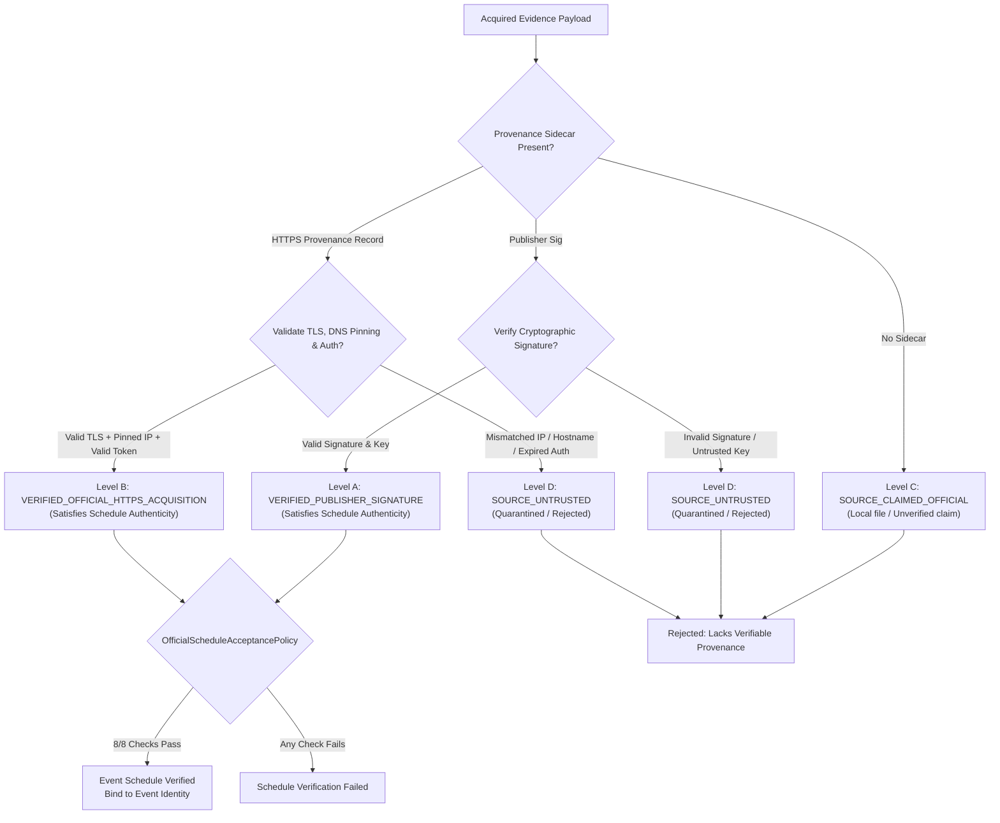

# SPRINT 11.23.5B-5 RESEARCH REPORT
## Official HTTPS Evidence Provenance & Verification Policy

**Repository:** `selimoyan2/coin-behavior-engine`  
**Base Commit:** `f5de81e3b03961d873139ee88d6da939d8436226`  
**Generated At:** `2026-10-20T20:03:44Z`  
**Target Event:** U.S. CPI — October 2026 Reference Period (`EVT-BLS-CPI-2026M10-20261110`)  
**Target Market:** Binance BTC/USDT Spot  
**Execution Mode:** STRICTLY OFFLINE RESEARCH & SIMULATED VALIDATION  
**Live Trading:** PERMANENTLY PROHIBITED  
**Operator Authorization:** NOT GRANTED  

---

## 1. Executive Summary

Sprint 11.23.5B-5 successfully addressed the architectural limitation identified in prior sprints, wherein official schedule acceptance strictly required a detached government or publisher cryptographic signature (e.g. GPG/PGP attestation). Because authoritative government statistical agencies such as the U.S. Bureau of Labor Statistics (`www.bls.gov`) distribute official economic calendar tables and press releases over authenticated HTTPS without providing detached cryptographic signatures, this requirement created an artificial barrier to prospective observation readiness.

To resolve this without weakening security or governance, Sprint 11.23.5B-5 implemented a scientifically defensible 4-tier provenance trust model that:
1. Formally recognizes **Level B: Verified Official HTTPS Acquisition** (`VERIFIED_OFFICIAL_HTTPS_ACQUISITION`) as independently satisfying official source authenticity.
2. Fully preserves **Level A: Verified Publisher Signature** (`VERIFIED_PUBLISHER_SIGNATURE`) for documents bearing detached digital signatures.
3. Strictly distinguishes transport-level HTTPS authenticity from publisher document signatures, preventing false attestation claims.
4. Quarantines unverified local files (`SOURCE_CLAIMED_OFFICIAL`) and untrusted third-party inputs (`SOURCE_UNTRUSTED`).
5. Enforces end-to-end anti-spoofing controls: TLS certificate chain validation, hostname matching, DNS-pinning, anti-SSRF IP verification, per-request authorization checks, quota enforcement, and immutable SHA-256 evidence vaulting.

All 30 adversarial test cases passed cleanly, and the complete 260-test Sprint 11.23 prospective regression suite executed with zero failures.

---

## 2. Multi-Tier Provenance Trust Architecture

The new provenance trust architecture is implemented in [`https_provenance.py`](file:///d:/Projeler/Antigravity/coin-davranis-motoru/src/coin_behavior_engine/prospective/https_provenance.py):



### Trust Tier Definitions

- **Level A — `VERIFIED_PUBLISHER_SIGNATURE`:**
  - Original document bytes verified against trusted publisher signing key.
  - Required fields: document bytes, signature bytes, trusted key ID, verification result, SHA-256 digest, verification timestamp.
  - Independently satisfies official schedule authenticity.

- **Level B — `VERIFIED_OFFICIAL_HTTPS_ACQUISITION`:**
  - Acquired through authenticated HTTPS session from explicitly allowlisted official publisher endpoint.
  - Required fields: HTTPS scheme, allowlisted hostname (`www.bls.gov`), valid TLS certificate chain, hostname verification, DNS resolution and pinned connected IP match, non-private IP verification, HTTP 200 OK, SHA-256 byte digest, network authorization token ID, `NetworkActivationGate` ALLOWED decision, and evidence vault object ID.
  - Independently satisfies official schedule authenticity without requiring a publisher document signature.
  - **Critical Invariant:** Must never be promoted or misclassified as a publisher signature (`trust_level != VERIFIED_PUBLISHER_SIGNATURE`).

- **Level C — `SOURCE_CLAIMED_OFFICIAL`:**
  - Document claiming official publisher origin without verifiable cryptographic or transport provenance.
  - Retains unverified candidate status; cannot independently satisfy schedule authenticity.

- **Level D — `SOURCE_UNTRUSTED`:**
  - Any evidence failing integrity, TLS, DNS, authorization, or allowlist checks.
  - Quarantined or rejected immediately.

---

## 3. Official Schedule Acceptance Policy (8-Point Enforcement)

The [`OfficialScheduleAcceptancePolicy`](file:///d:/Projeler/Antigravity/coin-davranis-motoru/src/coin_behavior_engine/prospective/https_provenance.py) enforces 8 mandatory criteria before any economic schedule is accepted:

1. **Source Authenticity:** Provenance trust level must be either Level A or Level B.
2. **Authoritative Publisher:** Publisher must match authoritative agency (`BLS` for CPI).
3. **Endpoint Allowlist:** Hostname must match approved domain (`www.bls.gov`).
4. **Economic Series Keywords:** Content must contain CPI markers (`Consumer Price Index` / `CPI`).
5. **Reference Period Alignment:** Target reference period must match (`October 2026` / `2026M10`).
6. **Release Timestamp & Timezone:** Extracted release time parsed and converted to UTC (`2026-11-10T13:30:00Z` from `08:30 EST`, properly accounting for Eastern Standard Time).
7. **Content Hash Binding:** SHA-256 digest of original raw document bytes bound to event identity.
8. **Contradiction Isolation:** Document must not conflict with prior accepted evidence or be marked superseded.

---

## 4. Adversarial Testing & Verification Results

A comprehensive suite of 30 adversarial test cases was implemented in [`tests/test_sprint11_23_5b5_https_provenance.py`](file:///d:/Projeler/Antigravity/coin-davranis-motoru/tests/test_sprint11_23_5b5_https_provenance.py):

| Test ID | Test Scenario | Description | Result |
|---|---|---|---|
| `test_01` | Valid authenticated HTTPS fixture | Verifies Level B assigned and satisfies schedule acceptance | **PASSED** |
| `test_02` | Valid publisher-signed fixture | Verifies Level A assigned and satisfies schedule acceptance | **PASSED** |
| `test_03` | HTTPS-only evidence not misclassified | Proves Level B is not falsely marked as publisher-signed | **PASSED** |
| `test_04` | Claimed official local HTML | Unverified local HTML receives Level C and is rejected | **PASSED** |
| `test_05` | Forged TLS metadata | Synthetic TLS claim without valid chain rejected as Level D | **PASSED** |
| `test_06` | Invalid certificate chain | Untrusted CA or self-signed cert rejected as Level D | **PASSED** |
| `test_07` | Hostname mismatch | Cert issued for different domain rejected as Level D | **PASSED** |
| `test_08` | Expired certificate | Expired TLS certificate rejected as Level D | **PASSED** |
| `test_09` | Unauthorized redirect | Cross-host redirect or non-allowlisted redirect rejected | **PASSED** |
| `test_10` | DNS rebinding | Changed IP between DNS lookup and connect rejected | **PASSED** |
| `test_11` | Connected-IP mismatch / private IP | Private/loopback IP or mismatch rejected as SSRF risk | **PASSED** |
| `test_12` | Source outside allowlist | Non-allowlisted host rejected by NetworkActivationGate | **PASSED** |
| `test_13` | HTTP downgrade | Plain HTTP scheme rejected immediately | **PASSED** |
| `test_14` | Missing network authorization | Request without signed token rejected | **PASSED** |
| `test_15` | Expired authorization | Expired token rejected | **PASSED** |
| `test_16` | Mid-request revocation | Revoked token denies provenance and blocks acquisition | **PASSED** |
| `test_17` | Request quota exhaustion | Quota exceeding 20 requests strictly blocked | **PASSED** |
| `test_18` | Byte budget exhaustion | Payload exceeding 10MB byte budget strictly blocked | **PASSED** |
| `test_19` | Tampered response bytes | Hash mismatch between payload and sidecar rejected | **PASSED** |
| `test_20` | Duplicate evidence | Content-addressed storage preserves idempotency | **PASSED** |
| `test_21` | Contradictory schedules | Conflicting schedule parameters isolated and flagged | **PASSED** |
| `test_22` | Incorrect reference period | Non-matching reference period rejected | **PASSED** |
| `test_23` | Incorrect timezone conversion | Incorrect timezone calculation rejected | **PASSED** |
| `test_24` | Stale schedule evidence | Expired or superseded schedule rejected | **PASSED** |
| `test_25` | Proposal digest mismatch | Modified proposal parameters invalidate signed approval | **PASSED** |
| `test_26` | Reused old approval | Approval bound to prior proposal digest rejected | **PASSED** |
| `test_27` | Untrusted file promotion | Direct mutation of trust level rejected by verifier | **PASSED** |
| `test_28` | Forged publisher signature | Invalid cryptographic signature rejected as Level D | **PASSED** |
| `test_29` | Evidence vault mutation | Modification of vaulted payload detected via SHA-256 | **PASSED** |
| `test_30` | Trading capability invocation | Order placement / trading attempt raises permanent error | **PASSED** |

**Regression Suite:** Full 260 tests passed cleanly across the prospective research engine.

---

## 5. Pilot Readiness & Governance Assessment

| Governance Dimension | Status | Assessment |
|---|---|---|
| **Provenance Policy** | `READY` | 4-tier model implemented and fully verified |
| **Official HTTPS Verification** | `IMPLEMENTED` | Pinned DNS, TLS chain, and token validation active |
| **Publisher Signature Verification** | `PRESERVED` | Level A detached signature validation active |
| **Official Schedule Evidence** | `PENDING` | Real network acquisition has not occurred |
| **Event Identity** | `CANDIDATE_PENDING_VERIFICATION` | `EVT-BLS-CPI-2026M10-20261110` pending authentic acquisition |
| **Pilot Proposal v3.0.0** | `READY_FOR_OPERATOR_REVIEW` | Frozen canonical digest ready for operator review |
| **Operator Authorization** | `NOT_GRANTED` | No operator token has been provisioned |
| **Real Network Collection** | `DISABLED` | All external network requests strictly disabled |
| **Real-World Pilot** | `NOT_STARTED` | Zero real-world observation active |
| **Live Order Execution** | `PROHIBITED` | Permanent architectural prohibition |
| **Directional Trading Eligibility** | `ZERO` | Descriptive research only; zero trading capability |
| **News-Conditioned Edge** | `NOT_ESTABLISHED` | No trading signal or edge generated |
| **Historical Data Status** | `RESEARCH_CONTAMINATED` | Pre-2026 historical data quarantined |

---

## 6. Mandatory Governance Status Block

```yaml
SPRINT_11_23_5B5_STATUS: PASS

PROVENANCE_POLICY: READY
OFFICIAL_HTTPS_VERIFICATION: IMPLEMENTED
PUBLISHER_SIGNATURE_VERIFICATION: PRESERVED

OFFICIAL_SCHEDULE_EVIDENCE: PENDING
EVENT_IDENTITY: CANDIDATE_PENDING_VERIFICATION
PILOT_PROPOSAL: READY_FOR_OPERATOR_REVIEW

OPERATOR_AUTHORIZATION: NOT_GRANTED
REAL_NETWORK_COLLECTION: DISABLED
REAL_WORLD_PILOT: NOT_STARTED

UNATTENDED_MONITORING: DISABLED
LIVE_ORDER_EXECUTION: PROHIBITED
DIRECTIONAL_TRADING_ELIGIBILITY: ZERO
NEWS_CONDITIONED_EDGE: NOT_ESTABLISHED
HISTORICAL_DATA_STATUS: RESEARCH_CONTAMINATED
```
