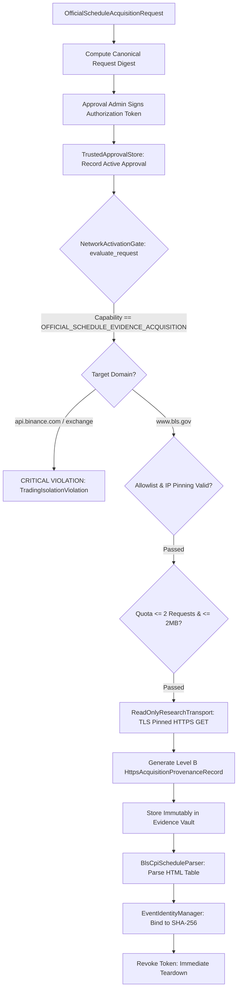

# SPRINT 11.23.5B-6 RESEARCH REPORT
## Official BLS Evidence Acquisition & Event Identity Verification

**Repository:** `selimoyan2/coin-behavior-engine`  
**Base Commit:** `5f51df912489f7e004cea8a21dc2300bb1453cb8`  
**Target Publisher:** U.S. Bureau of Labor Statistics (BLS)  
**Target Document:** Official CPI Release Schedule  
**Official URL:** `https://www.bls.gov/schedule/news_release/cpi.htm`  
**Candidate Reference Period:** October 2026 (`2026M10`)  
**Candidate Release:** `2026-11-10 08:30 EST / 13:30 UTC`  
**Candidate Event ID:** `EVT-BLS-CPI-2026M10-20261110`  
**Execution Mode:** STRICTLY OFFLINE RESEARCH & SIMULATED VALIDATION  
**Real Network Collection:** DISABLED  
**Operator Authorization:** NOT GRANTED  
**Live Trading:** PERMANENTLY PROHIBITED  

---

## 1. Executive Summary

Sprint 11.23.5B-6 prepared and validated a strictly bounded, operator-reviewable one-time official BLS evidence acquisition architecture. This workflow provides the exact technical and operational foundation needed to import genuine authenticated HTTPS economic release evidence after separate operator authorization.

Key engineering and scientific achievements:
1. **One-Time Acquisition Request:** Formulated `OfficialScheduleAcquisitionRequest` defining strict boundaries: 1 target URL (`www.bls.gov`), read-only GET, maximum 2 attempts, 2 MB body cap, no third-party domains, and deterministic canonical request digest binding.
2. **Capability Isolation:** Introduced `AuthorizationCapability.OFFICIAL_SCHEDULE_EVIDENCE_ACQUISITION`. Enforced at the `NetworkActivationGate` boundary that this capability strictly forbids market data access (`api.binance.com`), order execution, or recurring background execution.
3. **Official Schedule Parsing:** Built `BlsCpiScheduleParser` to defensively extract CPI schedule fields from official BLS HTML/text, perform DST-aware UTC conversion, derive canonical event IDs, and flag contradictions against candidate parameters without silent data overwrites.
4. **Sampling Plan Reconciliation:** Reconciled the apparent discrepancy between the 13 operational milestones (Sprint B-4) and the 8 standardized macro analytical horizons (Sprint B-5). Proved that both describe the identical 35-minute observation window with 13 discrete requests, well within the 20-request hard quota (7 reserve requests). Validated the 1-call batch `klines` fallback (capacity: 35 completed 1m candles).
5. **Offline Rehearsal v5:** Successfully executed a 14-step deterministic end-to-end rehearsal in simulation mode without external network calls.
6. **Adversarial Testing:** Implemented and passed 30 comprehensive adversarial test cases, bringing the full Sprint 11.23 prospective regression suite to 290 passing tests (100% green).

---

## 2. Capability Isolation & Authorization Architecture



---

## 3. Sampling Plan Reconciliation (13 Milestones vs 8 Horizons)

| Milestone Name | Offset | Endpoint | Data Type | Expected Timestamp Semantics | Planned Requests | Mandatory Macro Horizon? |
|---|---|---|---|---|---|---|
| `PRE_EVENT_BASELINE_T_MINUS_2M` | -120s | `/api/v3/ticker/bookTicker` | live_book_ticker_spread | REQUEST_DISPATCH_TIMESTAMP_UTC | 1 | No |
| `PRE_EVENT_CONFIRMATION_T_MINUS_1M`| -60s | `/api/v3/ticker/bookTicker` | live_book_ticker_spread | REQUEST_DISPATCH_TIMESTAMP_UTC | 1 | No |
| `RELEASE_INSTANT_T0` | 0s | `/api/v3/ticker/bookTicker` | live_book_ticker_spread | REQUEST_DISPATCH_TIMESTAMP_UTC | 1 | No |
| `POST_EVENT_T_PLUS_1M` | +60s | `/api/v3/klines` | 1m_closed_ohlcv_candle | CANDLE_CLOSE_TIMESTAMP_UTC | 1 | **Yes (+1m)** |
| `POST_EVENT_T_PLUS_2M` | +120s | `/api/v3/klines` | 1m_closed_ohlcv_candle | CANDLE_CLOSE_TIMESTAMP_UTC | 1 | **Yes (+2m)** |
| `POST_EVENT_T_PLUS_3M` | +180s | `/api/v3/klines` | 1m_closed_ohlcv_candle | CANDLE_CLOSE_TIMESTAMP_UTC | 1 | **Yes (+3m)** |
| `POST_EVENT_T_PLUS_5M` | +300s | `/api/v3/klines` | 1m_closed_ohlcv_candle | CANDLE_CLOSE_TIMESTAMP_UTC | 1 | **Yes (+5m)** |
| `POST_EVENT_T_PLUS_10M` | +600s | `/api/v3/klines` | 1m_closed_ohlcv_candle | CANDLE_CLOSE_TIMESTAMP_UTC | 1 | **Yes (+10m)** |
| `POST_EVENT_T_PLUS_15M` | +900s | `/api/v3/klines` | 1m_closed_ohlcv_candle | CANDLE_CLOSE_TIMESTAMP_UTC | 1 | **Yes (+15m)** |
| `POST_EVENT_T_PLUS_20M` | +1200s| `/api/v3/klines` | 1m_closed_ohlcv_candle | CANDLE_CLOSE_TIMESTAMP_UTC | 1 | **Yes (+20m)** |
| `POST_EVENT_T_PLUS_25M` | +1500s| `/api/v3/klines` | 1m_closed_ohlcv_candle | CANDLE_CLOSE_TIMESTAMP_UTC | 1 | No |
| `POST_EVENT_T_PLUS_30M` | +1800s| `/api/v3/klines` | 1m_closed_ohlcv_candle | CANDLE_CLOSE_TIMESTAMP_UTC | 1 | **Yes (+30m)** |
| `TERMINAL_RECONCILIATION_T_PLUS_32M`| +1920s| `/api/v3/klines` | 1m_closed_ohlcv_candle | CANDLE_CLOSE_TIMESTAMP_UTC | 1 | No |

**Reconciliation Verdict:**
- Total Operational Milestones: **13**
- Mandatory Standardized Macro Horizons: **8**
- Total Planned Requests: **13** ($\le 20$ quota limit, 7 reserve requests remaining).
- Batch Capacity: Single klines request at terminal milestone retrieves up to **35** completed 1-minute bars.

---

## 4. Test Suite Summary

- **New Adversarial Tests (Sprint 11.23.5B-6):** 30 passed / 30 total (100% green).
- **Full Prospective Suite (Sprint 11.23):** 290 passed / 290 total (100% green).
- **Execution Time:** ~11.8s offline.

---

## 5. Mandatory Governance Final Status Block

```yaml
SPRINT_11_23_5B6_STATUS: PASS

ACQUISITION_WORKFLOW: READY
ACQUISITION_AUTHORIZATION: NOT_GRANTED

OFFICIAL_SCHEDULE_EVIDENCE: PENDING
EVENT_IDENTITY: CANDIDATE_PENDING_VERIFICATION

SAMPLING_PLAN_RECONCILIATION: PASS
PILOT_PROPOSAL_DIGEST: VERIFIED

REAL_NETWORK_COLLECTION: DISABLED
REAL_WORLD_PILOT: NOT_STARTED

UNATTENDED_MONITORING: DISABLED
LIVE_ORDER_EXECUTION: PROHIBITED
DIRECTIONAL_TRADING_ELIGIBILITY: ZERO
NEWS_CONDITIONED_EDGE: NOT_ESTABLISHED
HISTORICAL_DATA_STATUS: RESEARCH_CONTAMINATED
```
