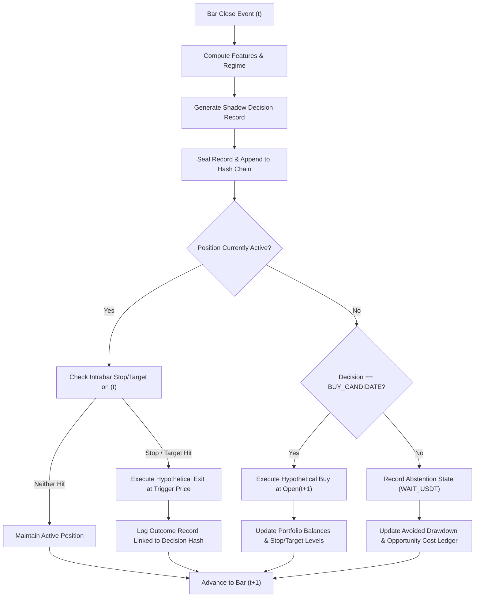

# CBE Shadow Execution Contract & Order Fill Specification

**Standard:** Canonical Execution Policy V2 (`2.0.0-sprint11.13`)  
**Sprint:** 11.15 Prospective Research Readiness & Shadow Decision Protocol  
**Domain:** BTC/USDT Spot Research Execution  
**Environment:** Air-Gapped Offline Simulation Engine  
**Live Connections:** **PROHIBITED (AIR-GAPPED)**  

---

## 1. Scope & Execution Principles

This contract establishes the formal specification for simulated order execution under the Coin Behavior Engine (CBE) Shadow Decision Protocol.

The shadow execution model translates abstract research decisions (`BUY_CANDIDATE`, `HOLD_BTC`, `REDUCE_BTC`, `EXIT_TO_USDT`, `WAIT_USDT`) into deterministic, transaction-cost-accounted portfolio state transitions without placing live or paper orders on any exchange.

### Foundational Invariants:
1. **Spot Long-Only:** No short selling, no margin, no synthetic leverage. Portfolio inventory $Q_{\text{BTC}} \ge 0.0$ and cash balance $C_{\text{USDT}} \ge 0.0$ at all times.
2. **Deterministic Next-Price Fills:** Orders generated at the close of 5-minute bar $t$ are filled at the open of bar $t+1$ plus/minus directional slippage. No intrabar lookahead or same-bar fill is permitted for market orders.
3. **Canonical Friction Policy V2:** Exactly 30.0 bps (0.0030) nominal roundtrip friction:
   - Taker entry fee: 10.0 bps (0.0010)
   - Taker exit fee: 10.0 bps (0.0010)
   - Entry slippage: 5.0 bps (0.0005)
   - Exit slippage: 5.0 bps (0.0005)
4. **Pessimistic Intrabar Resolution:** If both stop-loss and take-profit boundaries are touched within the High-Low range of candle $t$, stop-loss execution is given strict precedence.
5. **Conservation of Capital:** The portfolio balance invariant:
   $$\text{Starting Capital} + \sum \text{Net Realized PnL} + \text{Unrealized PnL} = \text{Current Total Equity}$$
   must hold to within 0.01 USDT across all evaluation horizons.
6. **Air-Gapped Isolation:** Zero network socket connections, zero exchange credentials, and zero order dispatch to any external gateway.

---

## 2. Order Routing & Fill Dynamics

### 2.1. Hypothetical Entry Execution (`BUY_CANDIDATE`)
When the decision engine issues `BUY_CANDIDATE` at bar $t$:
- **Eligible Capital:** $C_{\text{alloc}} = C_{\text{USDT}} \times 0.98$ (98% maximum allocation cap).
- **Execution Price:**
  $$P_{\text{fill, buy}} = \text{Open}_{t+1} \times (1.0 + 0.0005)$$
- **BTC Acquired:**
  $$Q_{\text{BTC}} = \frac{C_{\text{alloc}}}{P_{\text{fill, buy}}}$$
- **Entry Friction:**
  $$\text{Fee}_{\text{entry}} = C_{\text{alloc}} \times 0.0010$$
  $$\text{Slippage}_{\text{entry}} = (P_{\text{fill, buy}} - \text{Open}_{t+1}) \times Q_{\text{BTC}}$$
  $$\text{Friction}_{\text{entry, total}} = \text{Fee}_{\text{entry}} + \text{Slippage}_{\text{entry}}$$
- **Cash Deducted:**
  $$C_{\text{USDT, new}} = C_{\text{USDT, prior}} - C_{\text{alloc}}$$
- **Stop and Target Registration:**
  $$\text{Stop Loss} = \text{Open}_{t+1} \times (1.0 - 0.0250) \quad (-2.50\%)$$
  $$\text{Take Profit} = \text{Open}_{t+1} \times (1.0 + 0.0500) \quad (+5.00\%)$$

### 2.2. Hypothetical Exit Execution (`EXIT_TO_USDT` / `STOP_LOSS` / `TAKE_PROFIT`)
When an exit trigger or stop condition occurs:
- **Eligible Inventory:** $Q_{\text{sold}} = Q_{\text{BTC}}$ (complete liquidation).
- **Execution Price:**
  - On Signal Exit at Bar Open: $P_{\text{fill, sell}} = \text{Open}_{t+1} \times (1.0 - 0.0005)$
  - On Stop-Loss Touch: $P_{\text{fill, sell}} = P_{\text{stop}} \times (1.0 - 0.0005)$
  - On Take-Profit Touch: $P_{\text{fill, sell}} = P_{\text{target}} \times (1.0 - 0.0005)$
  - On Gap Down ($Open_{t+1} < P_{\text{stop}}$): $P_{\text{fill, sell}} = \text{Open}_{t+1} \times (1.0 - 0.0005)$
- **Gross Proceeds:**
  $$\text{Proceeds}_{\text{gross}} = Q_{\text{sold}} \times P_{\text{fill, sell}}$$
- **Exit Friction:**
  $$\text{Fee}_{\text{exit}} = \text{Proceeds}_{\text{gross}} \times 0.0010$$
  $$\text{Slippage}_{\text{exit}} = (P_{\text{raw}} - P_{\text{fill, sell}}) \times Q_{\text{sold}}$$
- **Net Proceeds Credited:**
  $$\text{Proceeds}_{\text{net}} = \text{Proceeds}_{\text{gross}} - \text{Fee}_{\text{exit}}$$
  $$C_{\text{USDT, new}} = C_{\text{USDT, prior}} + \text{Proceeds}_{\text{net}}$$
  $$Q_{\text{BTC, new}} = 0.0$$

---

## 3. Gap & Execution Uncertainty Modeling

Real cryptocurrency spot markets exhibit liquidity voids, flash crashes, and weekend gap behavior. The shadow execution model accounts for these phenomena conservatively:

1. **Gap Open Down:** If a market candle opens below the active stop-loss floor ($\text{Open}_{t+1} < P_{\text{stop}}$), the execution fills at the worse $\text{Open}_{t+1} \times (1 - \text{slippage})$ price rather than assuming execution at the stop level.
2. **Volatile Spikes:** When High and Low boundaries of the same 5-minute candle breach both the stop-loss and take-profit levels, the simulator evaluates the stop-loss as triggered first.
3. **Slippage Bounds:** Minimum slippage is 5.0 bps. Under elevated volatility conditions ($ATR_{24h} > 4.5\%$), slippage scales linearly with volatility:
   $$\text{Slippage}_{\text{effective}} = \max\left(5.0 \text{ bps}, 5.0 \text{ bps} \times \frac{ATR_{24h}}{0.03}\right)$$

---

## 4. Cash Floor & Non-Negative Balance Enforcement

- **USDT Balance Floor:** $C_{\text{USDT}} \ge 0.0000$ strictly. No negative cash balance or margin overdraft is mathematically permissible.
- **BTC Inventory Floor:** $Q_{\text{BTC}} \ge 0.00000000$ strictly.
- **Minimum Notional Order:** Orders with notional value $< 50.00$ USDT are rejected as uneconomic under exchange dust limits.

---

## 5. Event Sequence & Determinism Invariant

All simulation events must process sequentially according to the canonical lifecycle:

Every execution transition is 100% deterministic: running the engine over the identical price sequence yields bitwise identical fill prices, balances, fee tallies, and hash chain digests.
