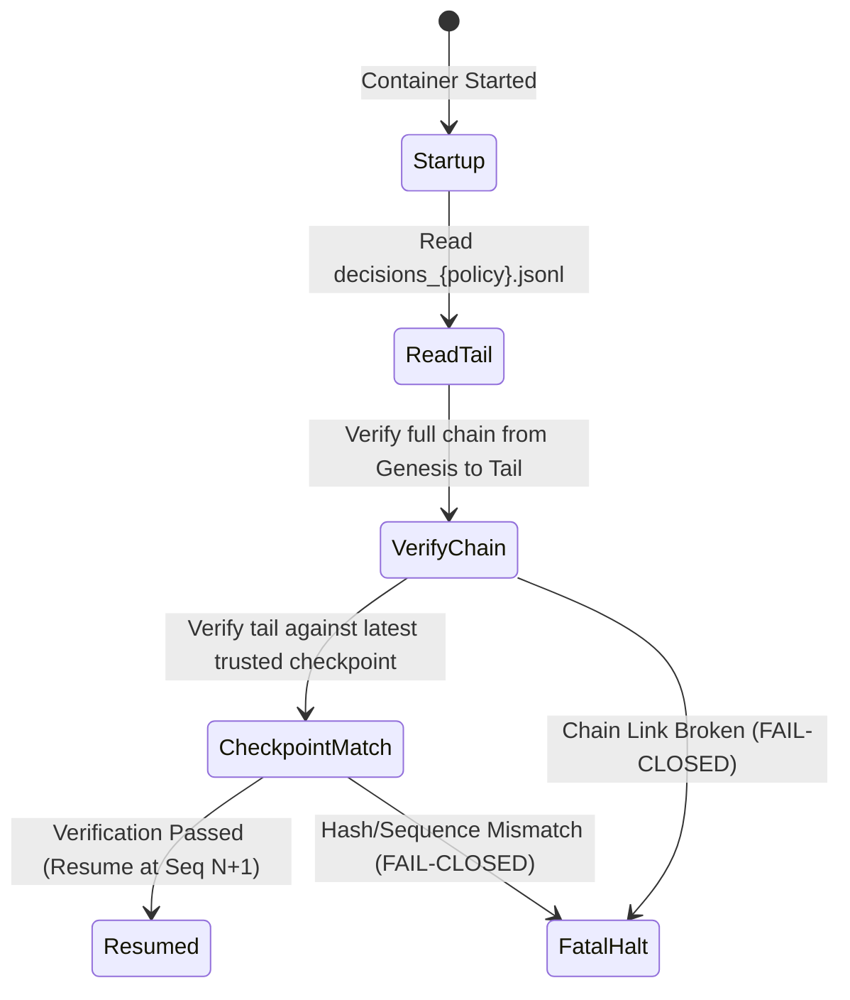

# CBE Sprint 11.16A — Shadow Storage & Cryptographic Checkpoint Plan

**Execution Mode:** Architecture Design & Preflight Verification Only — NO ACTIVATION  
**Target Volume:** Dedicated Named Volume `cbe_prospective_shadow_data_v1`  
**Base Code Commit:** `0a520ecc20cb45e9f8997a3f5a04e57e937d9c84`  

---

## 1. Storage Topology & Volume Layout

All prospective shadow outputs reside exclusively inside an independent Docker volume (`cbe_prospective_shadow_data_v1`) mounted at `/app/data/prospective_shadow`:

```text
/app/data/prospective_shadow/
├── metadata/
│   ├── shadow_engine_run_manifest.json          # Container startup parameters & code commit
│   └── policy_freeze_digest_manifest.json       # Exact frozen SHA-256 parameter hashes
├── decisions/
│   ├── decisions_POLICY_A_USDT_CASH.jsonl       # Append-only hash-chained decision records
│   ├── decisions_POLICY_B_BTC_BUY_AND_HOLD.jsonl
│   ├── decisions_POLICY_C_TREND48_FOLLOWING.jsonl
│   ├── decisions_POLICY_D_SELECTIVE_TREND_ONLY.jsonl
│   └── decisions_POLICY_E_SELECTIVE_ANALOGUE_ASSISTED.jsonl
├── checkpoints/
│   ├── checkpoint_epoch_daily.jsonl             # Daily sequence & hash checkpoints
│   └── anchors.manifest                         # External anchoring verification receipts
├── outcomes/
│   └── decoupled_horizon_outcomes.jsonl         # Causally decoupled subsequent outcomes
└── ledgers/
    ├── prospective_five_policy_equity_ledger.csv# Continuous tabular portfolio state
    └── recovery_audit_log.jsonl                 # Crash recovery audit entries
```

---

## 2. Append-Only Hash Chaining & Provenance

Every decision record emitted by the shadow engine is strictly append-only and cryptographically sealed into a recursive SHA-256 hash chain:

$$H_0 = \text{SHA256}(\text{CanonicalUTF8}(\text{Record}_0 \parallel \text{GenesisParent}))$$
$$H_i = \text{SHA256}(\text{CanonicalUTF8}(\text{Record}_i \parallel H_{i-1}))$$

### Provenance Tracking Invariants:
Every record must incorporate:
1. `source_identifier`: `binance_spot_btcusdt_5m_live_evidence`
2. `observation_timestamp_utc`: Candle closing timestamp $T_{\text{obs}}$.
3. `data_availability_timestamp_utc`: Earliest point in time data was accessible $T_{\text{avail}}$.
4. `code_commit_hash`: Exact Git commit `0a520ecc20cb45e9f8997a3f5a04e57e937d9c84`.
5. `parent_decision_hash`: Previous block hash $H_{i-1}$.

---

## 3. Trusted Checkpoint Anchoring (Without Exchange Connectivity)

Because the container runs under `network_mode: "none"`, external anchoring cannot rely on live HTTP/API transmission during scoring. A three-tier anchoring architecture is defined:

```mermaid
flowchart TD
    subgraph Container["Isolated Container (network_mode: none)"]
        REC["Decision Record i"] -->|Append & Seal| CHAIN["DecisionHashChain (Memory)"]
        CHAIN -->|fsync| JSONL["Local Volume JSONL Ledger"]
        CHAIN -->|Every 288 bars (24h)| CP["Local ChainCheckpoint File"]
    end

    subgraph Host["Host Server srv1114257 (Outside Container)"]
        CP -->|Volume Mount Read| EXPORT["Host Daily Checkpoint Harvester"]
        EXPORT -->|Daily Batch| ANCHOR["External Timestamp Commitment\n(Operator Git Tag / RFC-3161 Service)"]
    end
```

### 1. Internal Checkpoint Emission (Container Internal)
Every 288 bars (exactly 24 UTC hours), the shadow engine automatically generates a sealed `ChainCheckpoint`:
- `checkpoint_id`: `CP-20261019-2359-POLICY_D`
- `sequence_number`: Sequence index at 00:00 UTC (e.g. 287).
- `decision_hash`: The exact 64-character SHA-256 hash of that record.
- `chain_length`: Total records accumulated (e.g. 288).
- `code_commit_hash`: Frozen commit hash.
- Appended to `/app/data/prospective_shadow/checkpoints/checkpoint_epoch_daily.jsonl`.

### 2. External Anchoring Commitment (Host / Operator Level)
An independent host script or operator workflow periodically harvests the latest daily checkpoint hash and commits it externally via:
1. **Signed Git Tag:** `git tag -s shadow-checkpoint-20261019 -m "Hash: <hash>"` pushed to remote origin.
2. **RFC-3161 Digital Timestamp Authority:** Submitting the checkpoint hash to an independent RFC-3161 public TSA (e.g. DigiCert / Sectigo) for an immutable timestamp receipt (`.tsr`).

This establishes cryptographic immutability against retroactive tampering without requiring the container itself to have internet access.

---

## 4. Causally Decoupled Outcome Storage

Future market excursions and trade outcomes are recorded strictly in `/app/data/prospective_shadow/outcomes/decoupled_horizon_outcomes.jsonl`:
- **Parent Hash Reference:** Binds to `parent_decision_hash` $H_i$.
- **Zero Backward Mutation:** Emitting an outcome record **never** modifies the earlier decision record or recomputes historical decision hashes.
- **Abstention Metrics:** Decoupled calculation of avoided drawdown, missed appreciation, and opportunity cost for all `WAIT_USDT` periods.

---

## 5. Safe Crash Recovery & Interruption Protocol

If the shadow container crashes, terminates, or is stopped by an operator:



1. **Atomic Log Reading:** Upon startup, the engine reads existing JSONL decision files from `/app/data/prospective_shadow/decisions/`.
2. **Full Chain Verification:** Reconstructs the hash chain and verifies $H_i == \text{compute\_hash}(D_i)$ and $D_i.\text{parent\_hash} == H_{i-1}$ from block 0 to the tail.
3. **Truncation Check:** Compares the reconstructed chain length against `/app/data/prospective_shadow/checkpoints/checkpoint_epoch_daily.jsonl`. If records were lost or truncated, the engine triggers `FATAL_HALT_CHAIN_TRUNCATED` and refuses to score.
4. **Resumption:** If verification passes, the next record sequence number is initialized to $N = \text{len}(\text{chain})$ and execution resumes deterministically.
