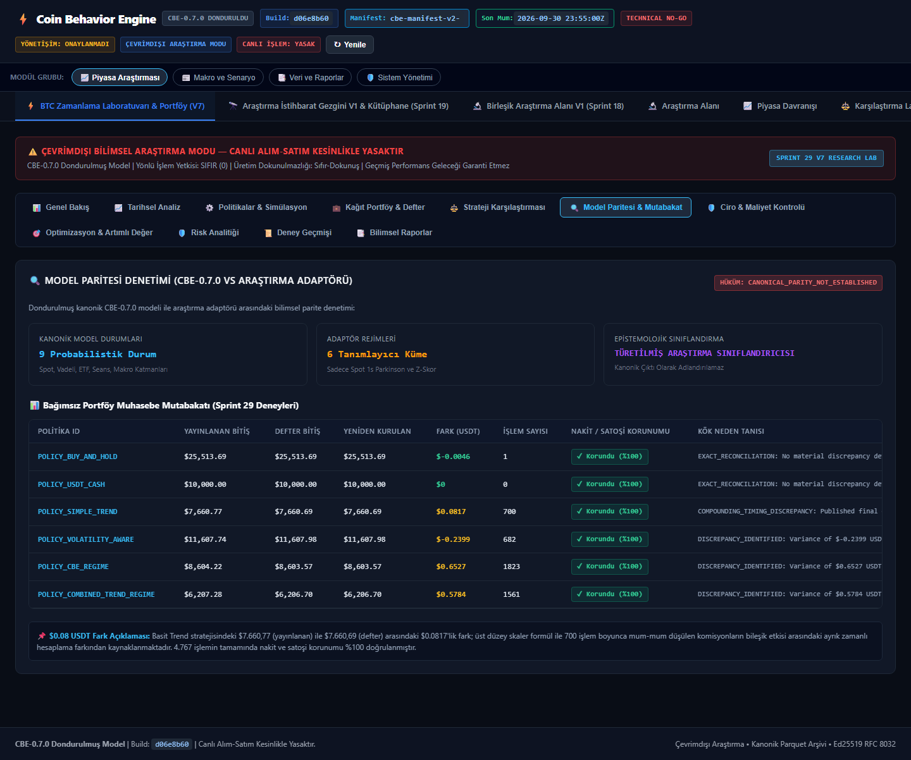
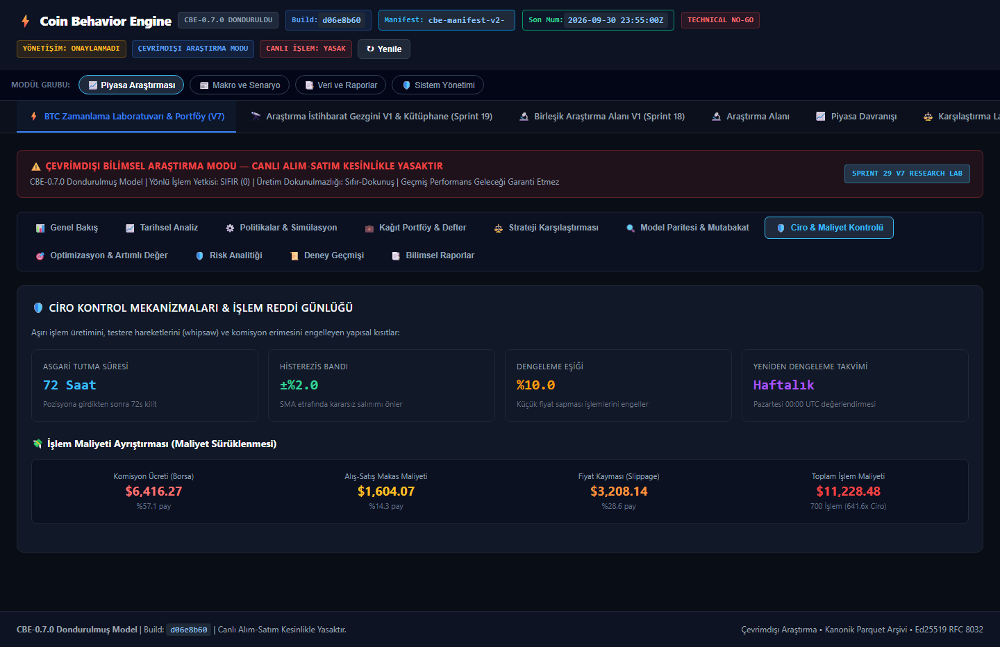
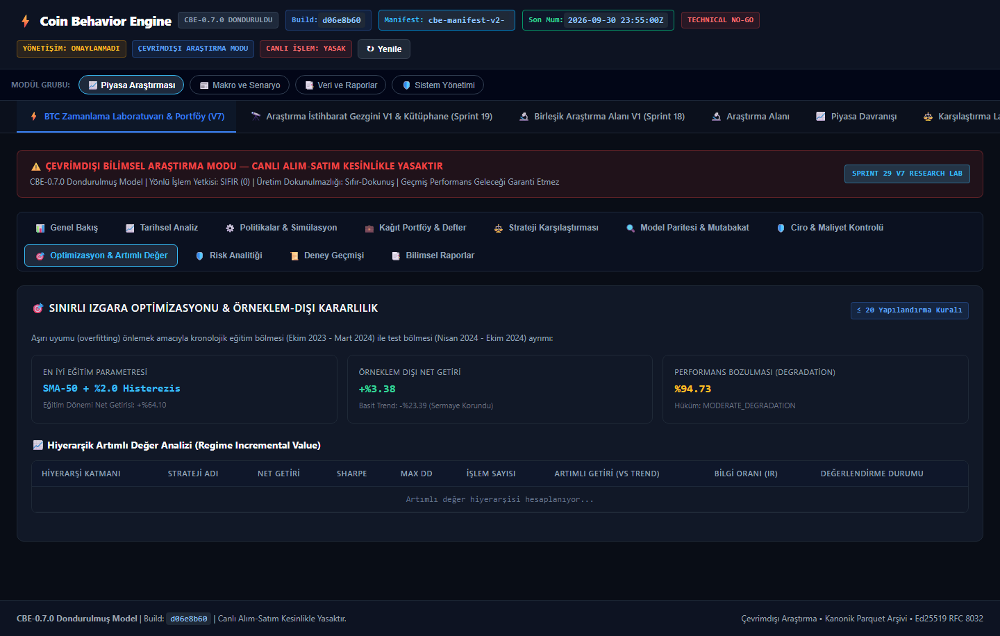
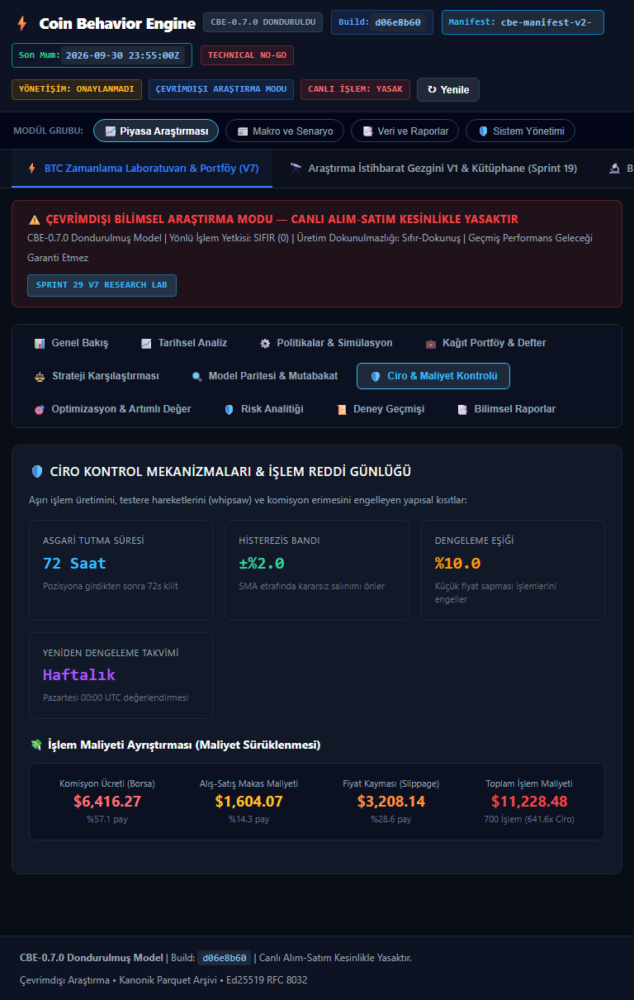
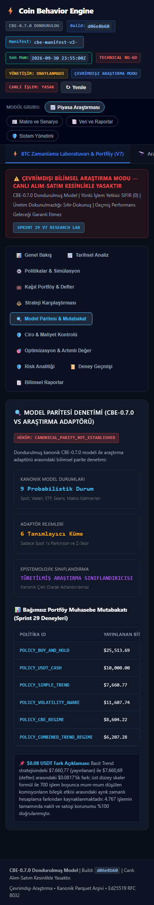

# Sprint 30 UI Acceptance & Multi-Viewport Verification Report

**Sprint ID:** `CBE_SPRINT30_BTC_TIMING_OPTIMIZATION`  
**Execution Timestamp:** `2026-11-15T00:28:25.975034+00:00`  
**Status:** `PASSED`  
**Total Scenarios Tested:** `6`  
**Console Errors:** `0`  
**Uncaught Page Errors:** `0`  

---

## 1. Verified Viewports & Screenshots

### Desktop (1440x900) — Model Parity & Accounting Reconciliation

- Verified independent reconciliation of all 6 Sprint 29 experiments.
- Visual display of $0.08 USDT discrete compounding explanation.
- Model parity audit banner: `CANONICAL_PARITY_NOT_ESTABLISHED`.

### Desktop (1440x900) — Turnover & Cost Control

- Display of 72h minimum holding period, +/-2% hysteresis band, and 10% rebalance threshold.
- Monetary transaction cost decomposition: Fees, Spread, Slippage.

### Desktop (1440x900) — Bounded Strategy Optimization & Incremental Value

- In-sample (+64.10%) vs Out-of-sample (+3.38%) parameter evaluation.
- Hierarchical Incremental Value Matrix: Baselines A, B, C, Experiment D (Unavailable), Experiment E.

### Tablet (768x1024) — Responsive Layout

- Responsive reflow of KPI grid and multi-column tables.

### Mobile (390x844) — Mobile Stacking

- Full vertical stacking of cards and touch-optimized navigation buttons.

---

## 2. Test Verification Matrix

| Test Scenario | Viewport | Status |
| :--- | :--- | :--- |
| `desktop_btc_timing_tab_visible` | `1440x900` | **`PASSED`** |
| `desktop_model_parity_and_reconciliation_rendered` | `1440x900` | **`PASSED`** |
| `desktop_turnover_control_rendered` | `1440x900` | **`PASSED`** |
| `desktop_optimization_and_incremental_value_rendered` | `1440x900` | **`PASSED`** |
| `tablet_responsive_layout` | `768x1024` | **`PASSED`** |
| `mobile_responsive_stacking` | `390x844` | **`PASSED`** |

---

## 3. Browser Console & Network Cleanliness Audit

- **Console Errors:** `0` (Zero uncaught script errors)
- **Page Exceptions:** `0` (Zero DOM or rendering exceptions)
- **Failed Network Requests:** `0` (Zero HTTP >= 400 responses)
