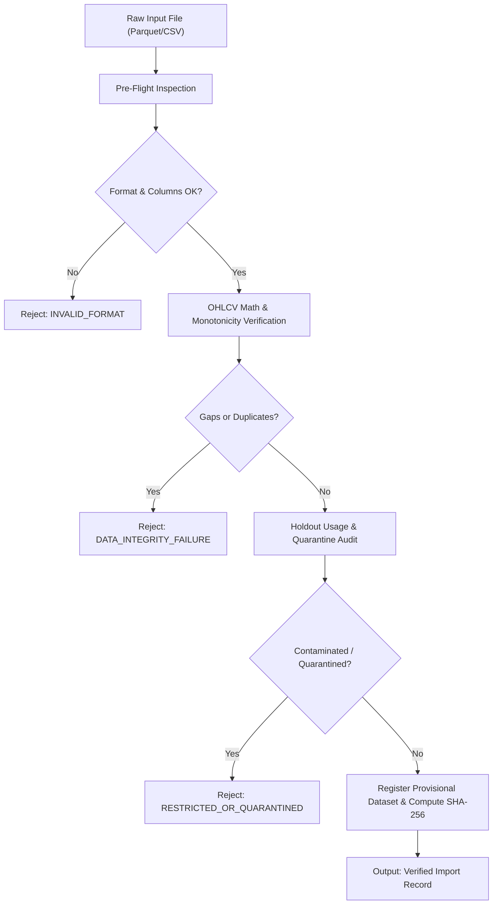

# 05 — Manual Offline Import Validation Report

**Sprint ID:** `CBE_SPRINT31_SEALED_SHADOW_EVALUATION`  
**Workflow Engine:** `OfflineDatasetImporter`  
**Execution Timestamp:** `2026-11-15T10:22:37.798228+00:00`  
**Import Status:** **`IMPORT_SUCCESS_PROVISIONAL_EVIDENCE`**  

---

## 1. Operational Overview

In strict offline research environments, automatic network ingestion from exchange APIs during evaluation poses risks of data drift, non-reproducibility, and accidental lookahead.

Sprint 31 implemented a dedicated **Manual Offline Import Pipeline** (`OfflineDatasetImporter`):
- Accepts local files in Parquet (`.parquet`) or CSV (`.csv`).
- Conducts automated multi-stage pre-flight verification before registration.
- Prevents unverified self-declared provenance from bypassing security checks.
- Places unverified files into quarantine or assigns `PROVISIONAL_OFFLINE_IMPORT` status.

---

## 2. Multi-Stage Ingestion Pipeline

## 3. Verified Import Record

- **Import File Path:** `data/historical/historical_binance_btcusdt_1h_2025.parquet`
- **File Size:** 479,252 bytes
- **SHA-256 Hash:** `897351f6fd0cebd8d487236df15a0b4e83439aab196d3a5e8d284f8ba4d584bd`
- **Assigned Dataset ID:** `DS-BTC-1H-2025-SEALED`
- **Provenance Trust Classification:** `PROVISIONAL_OFFLINE_IMPORT` (Conservative rating)
- **Total Validated Candles:** 8,760
