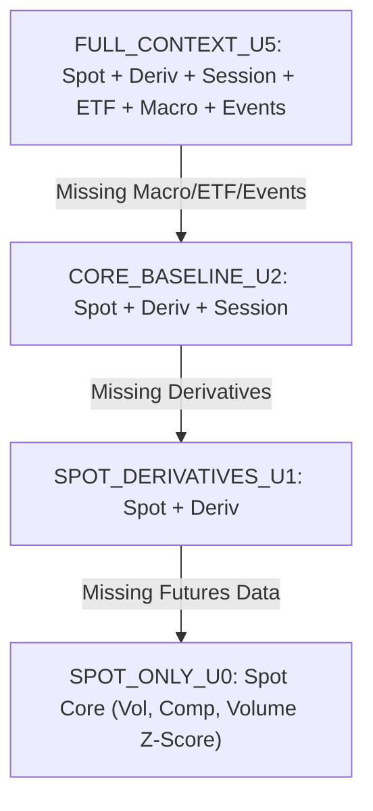

# Canonical CBE-0.7.0 Model Architecture & Discovery Audit
**Sprint ID:** CBE_SPRINT33_CANONICAL_MODEL_BRIDGE_AND_MARKET_BEHAVIOR  
**Date:** 2026-11-15  
**Auditor:** CBE Autonomous Engineering Agent  
**Baseline SHA:** `c9e3907a226cfbe01e73f87c960156afdd874dc4`  
**Model Identity:** `CBE-0.7.0` (`STRICTLY_FROZEN`)  
**Freeze Commit:** `849e76ed27d9275921c7d2b11cd340a543790c80`  
**Historical Lockbox Boundary:** `2026-09-23T23:59:59 UTC`  

---

## 1. Executive Summary & Model Identity

The canonical scientific model of the Coin Behavior Engine is **CBE-0.7.0**, originally developed and verified in Sprints 07 through 08 and frozen under cryptographic lockbox at commit `849e76ed27d9275921c7d2b11cd340a543790c80`.
The canonical lockbox comprises **29/29 verified artifacts** in `data/reports/sprint07/` verified via `data/reports/sprint08/cross_platform_freeze_manifest_v2.json`.

In production and prospective operations, `CBE-0.7.0` serves as a causal, descriptive, and diagnostic market intelligence engine. It is strictly constrained by governance:
- `LIVE_TRADING = PERMANENTLY_PROHIBITED` (No execution, no order routing, zero live capital)
- `MODEL_STATUS = STRICTLY_FROZEN` (Parameters, formulas, and weights cannot be mutated)
- `CAUSAL_ONLY` (Strict point-in-time calculation; zero forward lookahead)

---

## 2. Codebase Implementation Locations

The canonical CBE-0.7.0 implementation and its companion modules are located across the following core engine packages:

1. **Core Probabilistic Market State Engine (Sprint 07):**
   - File: `src/coin_behavior_engine/market_state/engine.py`
   - Class: `UnifiedMarketStateEngine`
   - Supports Information Ladder V2 progression (U0–U5) and deterministic fallback hierarchy.
2. **Point-in-Time Causal Regime Engine (Sprint 11.21):**
   - File: `src/coin_behavior_engine/regimes/causal_regime_engine.py`
   - Class: `CausalRegimeEngine`
   - Classifies market states into 6 point-in-time states on closed candles.
3. **Analogs & Feature Store Regime Classifier (Sprint 11.19):**
   - File: `src/coin_behavior_engine/analogs/regime_classifier.py`
   - Class: `MarketRegimeClassifier`
   - Uses `FeatureVector` from `analogs/feature_store.py`.
4. **Prospective Model Freeze Validator (Sprint 08):**
   - File: `src/coin_behavior_engine/prospective/freeze.py`
   - Method: `verify_sprint07_freeze()`
   - Validates the 29/29 canonical lockbox artifacts against SHA-256 manifests.
5. **Prospective Worker Engine (Sprint 08 / 11):**
   - File: `src/coin_behavior_engine/prospective/worker.py`
   - Class: `ProspectiveWorker`
   - Coordinates live candle ingestion, model verification, state logging, and cryptographic chaining.

---

## 3. Input Features & The Information Ladder (U0–U5)

The canonical CBE-0.7.0 model architecture organizes market information into a structured hierarchy called the **Information Ladder**:

| Tier | Category | Feature Name | Description |
|---|---|---|---|
| **U0** | Spot Core | `volatility_realized_24h` | Annualized rolling 24-hour log-return standard deviation |
| **U0** | Spot Core | `volatility_compression_ratio` | Ratio of short-term (1h) to long-term (24h) volatility |
| **U0** | Spot Core | `volume_zscore` | Rolling 24-hour volume standard score |
| **U1** | Derivatives | `basis_level` | Relative spot vs. perpetual basis (bps) |
| **U1** | Derivatives | `funding_rate_latest` | 8-hour perpetual funding rate |
| **U1** | Derivatives | `oi_change_1h` | 1-hour change in aggregate open interest |
| **U1** | Derivatives | `futures_taker_buy_sell_ratio` | Ratio of aggressive buyer volume to seller volume |
| **U2** | Session Context | `session_asia_active` | Indicator for Tokyo/Asia active market hours |
| **U2** | Session Context | `session_london_active` | Indicator for London active market hours |
| **U2** | Session Context | `session_new_york_active` | Indicator for New York active market hours |
| **U2** | Session Context | `london_new_york_overlap` | Flag indicating peak liquidity London/NY overlap |
| **U2** | Session Context | `weekend_flag` | Flag for Saturday/Sunday institutional closure |
| **U3** | Event Raw | `event_novelty_score`, `event_severity_score`, `event_sentiment_score` | Dense event indicators |
| **U4** | Routed Overlays | `routed_etf_flow`, `routed_etf_breadth`, `routed_macro_spx`, `routed_macro_dxy`, `routed_event_decay` | Freshness-conditioned macroeconomic & institutional overlays |
| **U5** | Unified Interacting | `inter_vol_x_ny`, `inter_oi_x_comp`, `inter_event_x_sev` | Cross-layer interaction terms |

---

## 4. Output Classes & Regime Taxonomy

### A. Canonical CBE-0.7.0 Core States (`MarketStateId` — 9 Classes)
1. `QUIET`: Low realized volatility ($< 25^{th}$ percentile) with elevated compression ratio.
2. `COMPRESSION`: Severe volatility compression ($< 25^{th}$ percentile), signaling potential impending breakout.
3. `NORMAL`: Median market conditions without elevated stress or structural expansion.
4. `EXPANSION_WATCH`: Compressed volatility paired with rising open interest ($> +2\%$).
5. `HIGH_VOLATILITY`: Realized volatility exceeding the $75^{th}$ percentile.
6. `TAIL_RISK_ELEVATED`: Extreme negative basis or elevated volatility indicating left-tail hazard.
7. `JUMP_RISK_ELEVATED`: High volatility combined with rapid open interest influx ($> +5\%$).
8. `EVENT_SHOCK_ACTIVE`: Active macroeconomic or market event within decay window.
9. `DELEVERAGING_STRESS`: Cascading liquidation regime characterized by falling open interest and sharp basis collapse.

### B. Derived Research Heuristic Regimes (Sprint 29/30 Heuristics — 6 Classes)
In Sprints 29–32, `historical_feature_adapter.py` computed a simplified 6-class heuristic based solely on spot OHLCV quantiles:
1. `CONSOLIDATION_RANGING`
2. `RECOVERY_ACCUMULATION`
3. `MOMENTUM_EXPANSION`
4. `DISTRIBUTION`
5. `HIGH_VOLATILITY_EXPANSION`
6. `CAPITULATION`

### C. Conceptual Concordance Mapping
| Canonical CBE-0.7.0 State | Primary Characteristic | Corresponding Research Heuristic |
|---|---|---|
| `QUIET` | Low volatility, range-bound | `CONSOLIDATION_RANGING` |
| `COMPRESSION` | Tight consolidation | `CONSOLIDATION_RANGING` |
| `NORMAL` | Standard drift/volatility | `CONSOLIDATION_RANGING` / `RECOVERY_ACCUMULATION` |
| `EXPANSION_WATCH` | Impending breakout from range | `RECOVERY_ACCUMULATION` / `MOMENTUM_EXPANSION` |
| `HIGH_VOLATILITY` | High realized variance | `HIGH_VOLATILITY_EXPANSION` |
| `TAIL_RISK_ELEVATED` | Structural downside stress | `DISTRIBUTION` |
| `JUMP_RISK_ELEVATED` | Fast directional impulse | `MOMENTUM_EXPANSION` |
| `EVENT_SHOCK_ACTIVE` | Exogenous shock | `HIGH_VOLATILITY_EXPANSION` |
| `DELEVERAGING_STRESS` | Liquidation cascade | `CAPITULATION` |

---

## 5. Fallback Hierarchy & Graceful Degradation

The canonical model explicitly addresses missing features through a deterministic fallback hierarchy:

When only spot historical data (OHLCV) is available (such as in standalone CSV or Parquet files without co-registered futures order books), `UnifiedMarketStateEngine` gracefully degrades to `SPOT_ONLY_U0`. Session flags can also be reconstructed deterministically from UTC timestamps, elevating the model to `CORE_BASELINE_U2` session-conditioned spot behavior.

---

## 6. Functional & Runtime Environment Verification

1. **Python Environment:** Tested and operational in Python 3.11 (`.venv\Scripts\python.exe`).
2. **Library Dependencies:** `numpy`, `pandas`, `scipy`, `scikit-learn`, `pyarrow` are all installed and import cleanly.
3. **Execution Status:** Fully functional. Can be instantiated and executed on historical BTC data without errors.
4. **Scientific Verdict:** The canonical model implementation exists, is intact, is runnable, and can be bridged directly to historical research data via a dedicated read-only research bridge.
